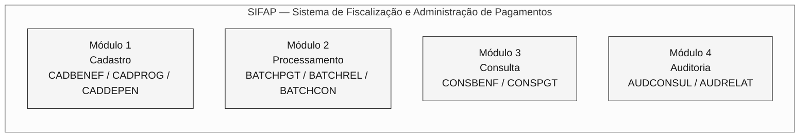
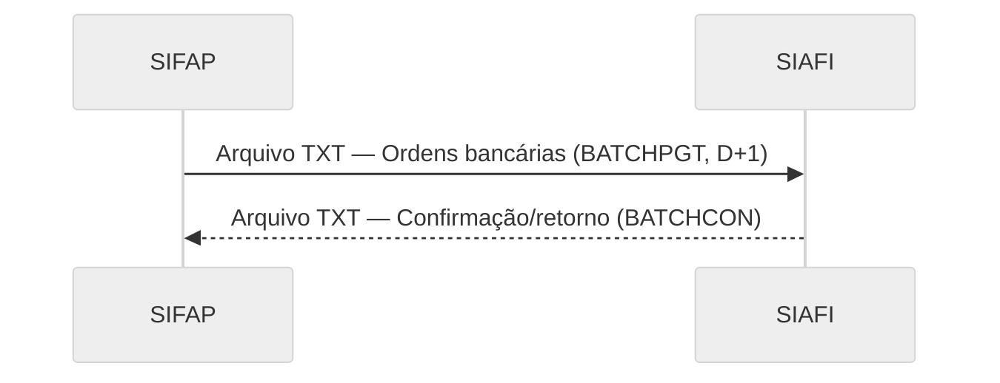
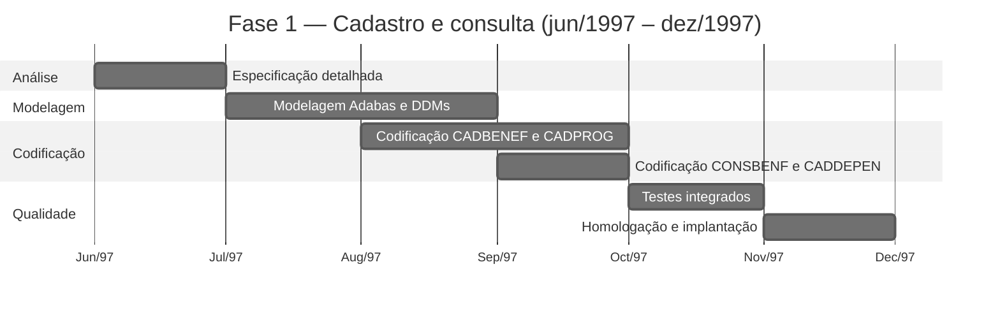
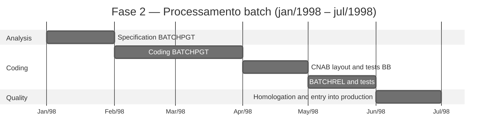

---

title: "Projeto SIFAP - Documento de Arquitetura Técnica"
author: "Roberto Carlos Ferreira - Analista de Sistemas Sênior"
date: "1997-05-20"
version: "1.0.0"
classification: "CONFIDENCIAL"
project: "SIFAP - Sistema de Fiscalização e Administração de Pagamentos"
sponsor: "SUPDE/DESIF - the organization"
client: "SAS/MPAS - Secretaria de Assistência Social"
---

> [!NOTE]
> Este é um documento histórico reconstituído para o exercício de arqueologia da imersão SIFAP 2.0. O documento simula a documentação técnica original de 1997, como teria sido produzida pela equipe SUPDE/DESIF. A linguagem da época e os nomes de pessoas e unidades organizacionais foram preservados intencionalmente. **Este documento não deve ser usado como especificação atual do sistema.** As lacunas e inconsistências registradas nos comentários fazem parte do exercício: representam os desafios reais de arqueologia que a equipe deve investigar.

<!-- ====================================================================== -->
<!-- PROJECT SIFAP - TECHNICAL ARCHITECTURE DOCUMENT -->
<!-- Version 1.0.0 - May 1997 -->
<!-- the organization - the federal data processing organization -->
<!-- Development Superintendence - SUPDE -->
<!-- Fiscal Systems Development Division - DESIF -->
<!-- ====================================================================== -->

# PROJETO SIFAP - DOCUMENTO DE ARQUITETURA TÉCNICA

**SISTEMA DE FISCALIZAÇÃO E ADMINISTRAÇÃO DE PAGAMENTOS**

---

|                      |                                       |
| -------------------- | ------------------------------------- |
| **Documento:** | ARQ-SIFAP-1997-v1.0 |
| **Classificação:** | CONFIDENCIAL |
| **Data de emissão:** | 20/05/1997 |
| **Projeto:** | SIFAP - Desenvolvimento inicial |
| **Prazo previsto:** | 14 meses (jun/1997 - jul/1998) |
| **Equipe:** | 8 analistas/programadores SUPDE/DESIF |
| **Coordenador:** | Roberto Carlos Ferreira |
| **Gerência:** | Antônio Marcos Silva - Gerente SUPDE |

---

> **Apresentação**
>
> Este documento descreve a arquitetura técnica proposta para o SIFAP, Sistema de Fiscalização e Administração de Pagamentos, a ser desenvolvido pela equipe SUPDE/DESIF da organização em resposta à demanda da Secretaria de Assistência Social do Ministério da Previdência e Assistência Social (SAS/MPAS).
>
> O SIFAP substituirá o atual sistema SIPAG/DOS, desenvolvido em Clipper e operado em microcomputadores nas regionais. A migração para uma plataforma mainframe busca garantir a centralização dos dados, a integridade das informações e a capacidade adequada de processamento para o crescimento previsto dos programas sociais federais.
>
> Este documento foi elaborado durante a fase de projeto, antes do início da codificação, e representa a **visão arquitetural planejada** para o sistema.

---

## 1. Introdução

### 1.1. Contexto

O Governo Federal, por meio do Ministério da Previdência e Assistência Social, administra diversos programas de transferência de renda para famílias em situação de vulnerabilidade social. Atualmente, o controle desses pagamentos é realizado pelo sistema SIPAG/DOS, uma aplicação desenvolvida em Clipper 5.2 que opera de forma descentralizada nas regionais da organização.

A descentralização do SIPAG/DOS causa os seguintes problemas:

- Impossibilidade de consolidação nacional em tempo hábil;
- Risco de duplicidade de cadastros entre regionais;
- Dificuldade de auditoria e acompanhamento;
- Limitação do volume de processamento (máximo de 200.000 registros por regional);
- Ausência de integração com sistemas financeiros federais (SIAFI).

### 1.2. Finalidade do SIFAP

Desenvolver um sistema centralizado, em plataforma mainframe, capaz de:

- Gerenciar um cadastro nacional unificado de beneficiários;
- Processar a folha mensal com volume projetado de até 5 milhões de beneficiários;
- Integrar-se ao SIAFI para conciliação financeira automatizada;
- Fornecer mecanismos de auditoria e fiscalização;
- Garantir disponibilidade e segurança compatíveis com a criticidade da operação.

### 1.3. Plataforma tecnológica escolhida

Após avaliar as alternativas disponíveis na infraestrutura da organização, foi escolhida a seguinte plataforma:

| Componente | Produto | Versão | Justificativa |
| ---------- | ---------- | ------- | ----------------------------------------------------------------------------------------------------------------------------- |
| Linguagem | Natural | 4.2.6 | Padrão da organização para desenvolvimento mainframe. Maior produtividade que COBOL em aplicações de cadastro/consulta. |
| SGBD | Adabas | 6.1.4 | SGBD invertido, alto desempenho em consultas por múltiplos descritores. Padrão da organização. |
| Monitor TP | Com\*plete | 6.1.2 | Monitor de teleprocessamento para telas 3270. Integrado ao Natural. |
| Agendador | JES2 | MVS/ESA | Subsistema padrão para processamento batch. |
| S.O. | MVS/ESA | 5.2.2 | Sistema operacional do mainframe da organização, Regional Brasília. |

> **Observação:** a escolha de Natural/Adabas segue a norma técnica da SUPDE (NT-SUPDE-003/1996), que estabelece essa plataforma como padrão para novos sistemas de cadastro e processamento de médio/grande porte.

---

## 2. Arquitetura modular

### 2.1. Módulos previstos

O SIFAP será organizado em **4 módulos funcionais**:



#### Módulo 1 - CADASTRO

Responsável pela manutenção dos dados cadastrais de beneficiários, dependentes e programas sociais.

| Programa previsto | Descrição | Prioridade |
| ----------------- | --------------------------------------------------------- | ---------- |
| CADBENEF | Cadastro de beneficiário, inclusão, alteração e exclusão | Fase 1 |
| CADPROG | Cadastro e parametrização de programas sociais | Fase 1 |
| CADDEPEN | Cadastro de dependentes do beneficiário | Fase 1 |

#### Módulo 2 - PROCESSAMENTO

Responsável pelo processamento batch da folha e pela geração de arquivos para integração.

| Programa previsto | Descrição | Prioridade |
| ----------------- | ------------------------------------------- | ---------- |
| BATCHPGT | Processamento mensal da folha | Fase 2 |
| BATCHREL | Geração de relatórios batch (totalizadores) | Fase 2 |
| BATCHCON | Conciliação financeira com o SIAFI | Fase 3 |

#### Módulo 3 - CONSULTA

Responsável pelas consultas online de cadastro e pagamentos.

| Programa previsto | Descrição | Prioridade |
| ----------------- | ------------------------------------------------- | ---------- |
| CONSBENF | Consulta de beneficiários por múltiplos critérios | Fase 1 |
| CONSPGT | Consulta de pagamentos por beneficiário/período | Fase 2 |

#### Módulo 4 - AUDITORIA

Responsável pelo registro e pela consulta de trilhas de auditoria e ocorrências de fiscalização.

| Programa previsto | Descrição | Prioridade |
| ----------------- | --------------------------------------------------- | ---------- |
| AUDCONSUL | Consulta da trilha de auditoria por período/usuário | Fase 3 |
| AUDRELAT | Relatório de ocorrências de auditoria | Fase 3 |

> **Total previsto:** 11 programas, distribuídos em 3 fases de desenvolvimento.

---

## 3. Modelo de dados

### 3.1. DDMs previstos

O SIFAP usará **3 DDMs** (Data Definition Modules) no Adabas:

```mermaid
%%{init: {'theme':'neutral','themeVariables':{'fontFamily':'ui-sans-serif, system-ui, sans-serif','primaryColor':'#F5F5F5','primaryTextColor':'#171717','primaryBorderColor':'#171717','lineColor':'#525252','secondaryColor':'#FFFFFF','tertiaryColor':'#FAFAFA','background':'#FFFFFF'}}}%%
erDiagram
    BENEFICIARY {
        string BN-NR-CPF PK
        string BN-NM-BENEF DE
        date BN-DT-NASC
        string BN-CD-SIT DE
        string BN-CD-PROG DE
        string BN-NR-NIS
        string BN-CD-REGIAO DE
        int BN-QT-DEPEND
        decimal BN-VL-RENDA-PC
        date BN-DT-ULT-ATUAL
        string BN-CD-BANCO
        string BN-CD-AGENCIA
        string BN-NR-CONTA
    }

    SOCIAL-PROGRAM {
        string PS-CD-PROG PK
        string PS-NM-PROG
        decimal PS-VL-MIN
        decimal PS-VL-MAX
        string PS-IN-ATIVO
        date PS-DT-INICIO
        date PS-DT-FIM
        string PS-VL-FAIXAS PE
    }

    PAYMENT {
        int PG-NR-SEQ PK
        string PG-NR-CPF DE
        string PG-CD-PROG DE
        string PG-AA-MM-REF DE
        decimal PG-VL-BRUTO
        decimal PG-VL-LIQ
        date PG-DT-CRED
        string PG-CD-STATUS DE
        string PG-CD-BANCO
    }

    BENEFICIARY ||--o{ PAYMENT : "gera"
    BENEFICIARY }o--|| SOCIAL-PROGRAM : "vincula-se a"
```

Legenda: PK = chave primária (superdescritor) · DE = descritor (índice Adabas) · PE = grupo periódico · MU = campo multivalorado

<!-- The DDM AUDIT (FNR 153) was not included in the original project.
 It was added in 2005, during the migration to Natural 6.3/Adabas 7.4,
 upon request from the Inspection Department (DEFIS).
 The audit programs (AUDCONSUL, AUDRELAT) provided for in this
 document were replaced by the program RELAUDIT in 2005. -->

### 3.2. Convenção de nomes de campos

Adotaremos a seguinte convenção para nomes de campos Adabas, conforme o padrão de nomenclatura da SUPDE (NT-SUPDE-007/1995):

| Prefixo | Entidade |
| ------- | --------------- |
| `BN-` | Beneficiário |
| `PS-` | Programa social |
| `PG-` | Pagamento |

Os sufixos indicam o tipo de dado:

| Sufixo | Significado | Exemplo |
| ------ | ---------------------- | -------------- |
| `NM-` | Nome/descrição | `BN-NM-BENEF` |
| `NR-` | Número/código numérico | `BN-NR-CPF` |
| `CD-` | Código/classificação | `BN-CD-SIT` |
| `DT-` | Data | `PG-DT-CRED` |
| `VL-` | Valor monetário | `PG-VL-BRUTO` |
| `QT-` | Quantidade | `BN-QT-DEPEND` |
| `IN-` | Indicador (S/N) | `PS-IN-ATIVO` |
| `SG-` | Sigla | (reservado) |

> **Restrição:** nomes de campos limitados a 20 caracteres, conforme limitação do Natural 4.2.

### 3.3. Estimativa inicial de volume

| DDM | Volume inicial | Crescimento estimado/ano | Projeção para 5 anos |
| --------------- | -------------------------- | ------------------------ | --------------- |
| BENEFICIARY | 1,200,000 (SIPAG migration) | 300,000 | 2,700,000 |
| SOCIAL-PROGRAM | 15 | 5 | 40 |
| PAYMENT | 0 (new) | 14,400,000 (1.2M x 12) | 72,000,000 |

> **Observação sobre a projeção:** consideramos crescimento linear de 25% ao ano no cadastro de beneficiários, compatível com a expansão prevista dos programas sociais do Governo Federal. A projeção pode variar conforme novas políticas públicas.

---

## 4. Fluxo de processamento batch

### 4.1. Diagrama do fluxo planejado

```mermaid
%%{init: {'theme':'neutral','themeVariables':{'fontFamily':'ui-sans-serif, system-ui, sans-serif','primaryColor':'#F5F5F5','primaryTextColor':'#171717','primaryBorderColor':'#171717','lineColor':'#525252','secondaryColor':'#FFFFFF','tertiaryColor':'#FAFAFA','background':'#FFFFFF'}}}%%
TB flowchart
    classDef step fill:#F5F5F5,stroke:#171717,color:#171717
    classDef artifact fill:#FAFAFA,stroke:#A3A3A3,color:#404040
    classDef result fill:#FFFFFF,stroke:#171717,color:#171717,stroke-width:2px

    START["Início do ciclo<br/>(1º dia útil)"]:::step
    PGT["BATCHPGT<br/>1. Ler BENEFICIARY<br/>2. Calcular valor<br/>3. Gravar PAYMENT<br/>4. Gerar CNAB"]:::step
    CNAB["Arquivo CNAB<br/>(remessa BB)<br/>Envio D+1"]:::artifact
    REL["BATCHREL<br/>Relatórios<br/>totalizadores"]:::step
    RET["Retorno BB<br/>(D+3)"]:::artifact
    CON["BATCHCON<br/>Conciliação<br/>CNAB x SIAFI"]:::result

    START --> PGT
    PGT --> CNAB
    PGT --> REL
    CNAB --> RET
    RET --> CON
```

### 4.2. Agendamento batch previsto

| Job | Frequência | Horário | Janela | Dependência |
| --------- | -------------- | ------- | ------ | ---------------------- |
| SIFAP-PGT | Monthly (1st DU) | 22:00 | 4h | None |
| SIFAP-REL | Monthly (2nd DU) | 06:00 | 1h | SIFAP-PGT (RC=0) |
| SIFAP-CON | Monthly (5th DU) | 22:00 | 2h | Receipt return BB |

<!-- In practice, the scheduling differed from what was planned. The BATCHREL became
 be executed both before (previous mode, D-1) and after (D+5) the
 BATCHPGT. BATCHCON has been brought forward to D+4. Furthermore, the program
 VALELEG started to be executed in batch mode (D-2), which was not
 foreseen in this original project. -->

### 4.3. Estimativa de tempo de processamento

Com base em benchmarks realizados no ambiente de homologação da organização (mainframe IBM 9672-R36, 256 MB de RAM):

| Job | Volume-base | Tempo estimado | Observação |
| --------- | -------------------- | -------------- | --------------------------------------- |
| SIFAP-PGT | 1,200,000 records | 1h30min | Sequential processing with I/O Adabas |
| SIFAP-REL | N/A | 20min | Totalizer reading |
| SIFAP-CON | ~1,200,000 records | 45min | Match between CNAB and PAYMENT |

> **Premissa:** estes tempos são estimativas baseadas no volume inicial. O crescimento da base de beneficiários implicará aumento proporcional do tempo de processamento. Recomenda-se revisar o dimensionamento quando o volume atingir 2.500.000 registros.

<!-- Volume reached 4,200,000 in 2018. BATCHPGT processing time
 reached 3h20min (reference Feb/2018), with a timeout incident in
 March/2016 when it processed 4.1M records. The sizing review
 recommended in this document has never been formally carried out. -->

---

## 5. Integração com o SIAFI

### 5.1. Modelo de integração previsto

A integração com o SIAFI, Sistema Integrado de Administração Financeira do Governo Federal, será realizada conforme o seguinte modelo:



**Formato previsto:** arquivo texto posicional, leiaute definido pela STN (Secretaria do Tesouro Nacional), conforme Instrução Normativa STN nº 04/1996.

**Meio de transmissão:** transferência via VTAM/SNA entre os mainframes da organização e da STN.

**Frequência:** mensal, D+2 após o processamento da folha.

### 5.2. Campos do arquivo de integração SIAFI

| Posição | Tamanho | Campo | Formato |
| ------- | ------- | ---------------------------------------------------- | ------- |
| 001-002 | 02 | Record Type (01=Header, 02=Detail, 99=Trailer) | N |
| 003-016 | 14 | Beneficiary's CPF | N |
| 017-056 | 40 | Name of beneficiary | A |
| 057-069 | 13 | Bank order value (11 integers + 2 decimals) | N |
| 070-077 | 08 | Credit date (YYYMMDD) | N |
| 078-080 | 03 | Paying bank code | N |
| 081-084 | 04 | Agency code | N |
| 085-094 | 10 | Account number | N |
| 095-100 | 06 | Reference year/month (YYYYMM) | N |
| 101-110 | 10 | Bank order code SIAFI | N |
| 111-130 | 20 | Reserve for future use | A |

<!-- Integration with SIAFI has not been implemented according to this layout.
 In 2002, when the integration was effectively carried out (version 2.5),
 the layout was redefined in conjunction with the STN, with additional fields
 for hash totalizer and social program code. The program
 BATCHCON implemented reconciliation based on the revised layout.
 This original document does not reflect the implemented version. -->

---

## 6. Segurança e controle de acesso

### 6.1. Modelo de acesso

O controle de acesso ao SIFAP será implementado em dois níveis:

1. **Nível Natural Security:** controle de acesso à biblioteca SIFAP e seus objetos, gerenciado pelo Natural Security (NATSEC). Perfis definidos:

- OPERATOR: acesso aos programas de cadastro e consulta;
- SUPERVISOR: acesso completo, incluindo exclusão e parametrização;
- AUDITOR: acesso somente leitura a todos os módulos + relatórios de auditoria.

1. **Nível da aplicação:** verificação adicional pela GDA de sessão (Global Data Area), contendo código do usuário, perfil e regional de origem.

### 6.2. Trilha de auditoria

Toda operação que alterar dados no sistema (inclusão, alteração, exclusão) gerará um registro de auditoria contendo:

- Código do usuário;
- Data e hora da operação;
- Programa que originou a operação;
- Tipo de operação (I=Inclusão, A=Alteração, E=Exclusão);
- Identificação do registro afetado;
- Valores anterior e posterior (para alterações).

> **Nota de projeto:** na fase inicial, os registros de auditoria serão gravados em campos do tipo MU (multiple value) no DDM BENEFIC, o arquivo de Beneficiários, usando um grupo periódico (PE) para o histórico. Essa abordagem simplifica a implementação e evita a criação de um DDM adicional.

<!-- This decision was reversed in 2005, when the volume of
 audit on PE of DDM BENEFIC caused severe degradation of
 performance. DDM AUDIT (FNR 153) was then created as an entity
 separately, and the subprogram LOGAUDIT was refactored to write to this
 new DDM. DBA Cláudia Regina dos Santos led the migration of
 existing audit records for the new file Adabas. -->

---

## 7. Evolução prevista

### 7.1. Roteiro de funcionalidades

A evolução do SIFAP está planejada nas seguintes fases, sujeitas à aprovação e priorização pelo comitê gestor do projeto:

| Fase | Prazo previsto | Funcionalidade | Prioridade |
| ---------- | -------------- | ----------------------------------------------------------------------------------------------------------------------------------------------------------------------- | ----------- |
| **Fase 1** | Jun-dez/1997 | Módulos de cadastro e consulta (CADBENEF, CADDEPEN, CADPROG, CONSBENF) | Obrigatória |
| **Fase 2** | Jan-jul/1998 | Módulo de processamento batch (BATCHPGT, BATCHREL) | Obrigatória |
| **Fase 3** | Ago-dez/1998 | Módulo de auditoria (AUDCONSUL, AUDRELAT) + conciliação SIAFI (BATCHCON) | Desejável |
| **Fase 4** | 1º semestre/1999 | Módulo de validação (VALBENEF, VALDOCS), validação cadastral automatizada | Desejável |
| **Fase 5** | 2º semestre/1999 | Geração de relatórios gerenciais avançados, gráficos e consolidações | Opcional |
| **Fase 6** | 1º semestre/2000 | **Módulo web**, interface de consulta via intranet para órgãos gestores (SENARC, SAS). Tecnologia prevista: Natural Web Interface + servidor HTTP da organização. | Opcional |
| **Fase 7** | 2º semestre/2000 | Integração online com a Receita Federal para validar CPF em tempo real | Opcional |

<!-- Balance of real evolution (retrospective annotation):

 Phase 1: COMPLETED (Dec/1997) - as planned, with a delay of 2 months.

 Phase 2: COMPLETED (Jul/1998) - as planned. Entry into production
 from v1.0 with modules CADBENEF, CADDEPEN, CADPROG, CONSBENF, BATCHPGT,
 BATCHREL.

 Phase 3: PARTIALLY COMPLETED (2002/2005) - BATCHCON has been implemented
 in 2002 (version 2.5), with a different SIAFI layout than planned. You
 audit programs AUDCONSUL and AUDRELAT were NEVER implemented
 as designed. In 2005, they were replaced by the RELAUDIT program,
 with reduced scope.

 Phase 4: COMPLETED WITH CHANGES (1999/2003) - VALBENEF has been implemented
 in 1999 (Phase 2 of v2.0). VALDOCS was implemented in 2003 by Patrícia
 Helena Moura. Program VALELEG (validation of
 eligibility), which was NOT included in the original project.

 Phase 5: NEVER IMPLEMENTED - Advanced reporting has never been
 developed. SIFAP reports remain in text format 132
 columns for dot matrix printer.

 Phase 6: NEVER IMPLEMENTED - The "web module" planned for 2000 never
 left the paper. The Natural Web Interface technology has not been adopted by
 the organization. Access to the SIFAP remains exclusively via 3270 emulation.

 Phase 7: IMPLEMENTED DIFFERENTLY (2002) - The query of CPF in
 Federal Revenue was implemented in 2002, but via transaction CICS and not
 via direct online integration as planned.

 UNSPECIFIED FEATURES:
 - CALCCORR (calculation of corrections/adjustments) - implemented in 2005
 by Marcos Antônio Ferreira during the migration to Natural 6.3.
 - CALCDSCT (discount calculation) - implemented in 2015 on demand
 from SENARC. This module was NOT included in any previous planning.
 - RELPGT (payment report) - implemented in 2003 by Patrícia
 Helena Moura. Replaced partial functionality of the BATCHREL.
 - DDM AUDIT (FNR 153) - created in 2005. The original project provided
 audit as PE in DDM BENEFIC.
 - CadÚnico Integration - implemented as an emergency in 2006, without
 program cataloged in the official inventory. -->

### 7.2. Premissas para evolução

- Manutenção de uma equipe de pelo menos 4 analistas/programadores Natural dedicados ao SIFAP;
- Disponibilidade de ambiente de homologação no mainframe da organização;
- Apoio do comitê gestor da SAS/MPAS para definir requisitos;
- Estabilidade da plataforma Natural/Adabas na organização (sem descontinuação prevista);
- Orçamento para adquirir licenças do Natural Web Interface (Fase 6).

### 7.3. Considerações sobre o módulo web (Fase 6)

O módulo web previsto para o 1º semestre de 2000 usará a tecnologia **Natural Web Interface** (NWI), que permite exibir telas Natural como páginas HTML acessíveis por navegador. Essa tecnologia está em avaliação pela organização e deverá ser homologada até o fim de 1998.

A interface web do SIFAP permitirá:

- Consulta de beneficiários por CPF, NIS ou nome (equivalente ao CONSBENF);
- Consulta de pagamentos por período;
- Emissão de extratos para órgãos gestores;
- Acesso pela intranet da organização (rede INFOVIA do Governo Federal).

> **Observação:** a viabilidade técnica do NWI depende da aprovação pelo Comitê de Arquitetura da organização. Se o NWI não for aprovado, avaliar alternativa com **Entire X** (middleware Natural-HTTP) ou desenvolvimento separado de front-end em Java/Servlet com acesso ao Adabas via JDBC.

---

## 8. Cronograma de desenvolvimento

### 8.1. Fase 1 - Cadastro e consulta



### 8.2. Fase 2 - Processamento batch



---

## 9. Equipe do projeto

| Nome | Papel no projeto | Lotação |
| ----------------------------- | -------------------------------------- | ----------- |
| Roberto Carlos Ferreira | Coordenador técnico / Arquiteto | SUPDE/DESIF |
| Maria Helena Costa | Coordenadora da DESIF / Patrocinadora técnica | SUPDE/DESIF |
| José Aparecido Lima | Programador Natural, módulo batch | SUPDE/DESIF |
| Fernanda Cristina de Oliveira | Analista de Negócio / Especificação | SUPDE/DESIF |
| Cláudia Regina dos Santos | DBA Adabas, modelagem de dados | SUPDE/DESIF |
| Antônio Carlos Ribeiro | Analista de Suporte, infraestrutura | SUPDE/DESIF |
| Mário Sérgio Andrade | Programador Natural, módulo de cadastro | SUPDE/DESIF |
| Sandra Lúcia Pereira | Programadora Natural, módulo de consulta | SUPDE/DESIF |

> **Observação:** Mário Sérgio Andrade e Sandra Lúcia Pereira deixaram o projeto em dezembro de 1997 devido a remanejamento interno. Suas atividades foram absorvidas pelas demais pessoas da equipe, contribuindo para o atraso de 4 meses no prazo original do projeto (14 meses planejados → 18 meses realizados).

---

## 10. Riscos identificados

| # | Risco | Probabilidade | Impacto | Mitigação |
| --- | ---------------------------------------------------------------- | ------------- | ------- | ------------------------------------------------ |
| R1 | Atraso na migração de dados do SIPAG/DOS | Alta | Alto | Iniciar o mapeamento de dados em paralelo à Fase 1 |
| R2 | Indisponibilidade do ambiente de homologação | Média | Alto | Solicitar ambiente dedicado à SUPDE |
| R3 | Alteração de requisitos pela SAS/MPAS durante o desenvolvimento | Alta | Médio | Congelar requisitos por fase |
| R4 | Saída de integrantes da equipe por remanejamento | Média | Alto | Documentar e compartilhar conhecimento |
| R5 | Limitação de desempenho do Adabas com volumes acima de 2 milhões de registros | Baixa | Alto | Monitorar e otimizar descritores |
| R6 | Descontinuação de Natural/Adabas pela organização | Baixa | Crítico | Seguir as diretrizes técnicas da SUPDE |

> **Note on R4:** This risk partially materialized with the departure of Mário Sérgio and Sandra Lúcia in December/1997. Mitigation through documentation and knowledge sharing was partially implemented, but the practice was not maintained throughout the life of the system.

---

## 11. Aprovações

Este documento foi revisado e aprovado para o início do desenvolvimento conforme as assinaturas abaixo:

---

**Roberto Carlos Ferreira**
Senior Systems Analyst - SUPDE/DESIF
Technical Coordinator of Project SIFAP
Brasilia, May 20, 1997

---

**Maria Helena Costa**
Coordinator - DESIF/SUPDE
Brasília, May 22, 1997

---

**Antônio Marcos Silva**
Manager - SUPDE
Development Superintendence
Brasília, May 26, 1997

---

## Apêndice A - Glossário do projeto

| Termo | Definição |
| ---------- | --------------------------------------------------------------------------------------- |
| Adabas | Adaptable Database System - Software AG's DBMS used on the organization's mainframe |
| CNAB | National Center for Banking Automation - file standard for banking transactions |
| Com\*plete | Software AG Teleprocessing Monitor for 3270 Displays |
| DDM | Data Definition Module - logical definition of file access Adabas in Natural |
| FROM | Descriptor - field indexed in Adabas, used as search criteria |
| FDT | Field Definition Table - physical definition of fields in a file Adabas |
| FNR | File Number - number that identifies a file in Adabas |
| GDA | Global Data Area - data area shared between Natural programs in the session |
| INFOVIA | Federal Government data communication network |
| JES2 | Job Entry Subsystem - batch job management subsystem in MVS |
| LDA | Local Data Area - local data area of ​​a program Natural |
| MU | Multiple Value - field that can contain multiple values ​​in Adabas |
| Natural | Software AG's 4GL programming language for mainframe environment |
| NWI | Natural Web Interface - technology for displaying Natural screens as HTML |
| PE | Periodic Group - group of fields that are repeated in Adabas (history) |
| SIAFI | Integrated Financial Administration System of the Federal Government |
| SIPAG/DOS | Payment System - Clipper application prior to SIFAP |
| SNA | Systems Network Architecture - IBM communication protocol |
| STN | National Treasury Secretariat |
| VTAM | Virtual Telecommunications Access Method - IBM communications software |

---

**the organization - the federal data processing organization**
**Documento confidencial**
**Reprodução e distribuição restritas ao âmbito do projeto SIFAP**

---

[Voltar ao cenário legado](../README.md)
