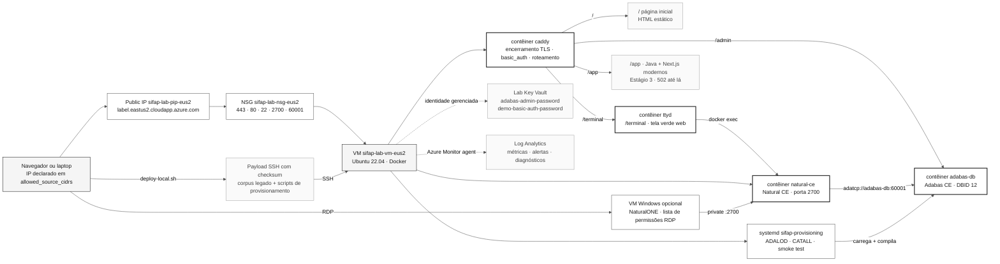

# Lab Adabas + Natural — runtime legado opcional

> **Trilha:** [Kit do Time](../../README.md) › [Estágio 1 — Arqueologia](../../01-archaeology/README.md) › **Lab Adabas + Natural**

**Provisiona uma VM do Azure em East US 2 que executa o Adabas Community Edition e o Natural Community Edition em contêineres, publicados por uma URL HTTPS estável de demonstração, para participantes que desejam executar os programas legados do SIFAP (Sistema de Fiscalização e Administração de Pagamentos), em vez de apenas lê-los.**

  

| Campo | Valor |
|---|---|
| **Público-alvo** | DevOps Engineer (Dupla 5) e quem deseja executar o sistema legado real |
| **Pré-requisitos** | Sua própria assinatura Azure, Azure CLI autenticada, Terraform 1.14.x, par de chaves SSH e um local seguro para backup do estado local do Terraform |
| **Tempo estimado** | 15 minutos de comandos, mais o tempo da primeira inicialização da VM |
| **Região** | `eastus2` (East US 2) |
| **Estágio** | Trilha opcional: apoio ao Estágio 1 (Arqueologia) |
| **Resultado esperado** | Adabas CE e Natural CE em execução em uma VM, acessíveis em `https://<label>.eastus2.cloudapp.azure.com` |

> [!CAUTION]
> Este módulo cria recursos pagos em uma assinatura Azure real. Leia [Controle de custos e gastos](#controle-de-custos-e-gastos) antes do primeiro `terraform apply`.

> [!IMPORTANT]
> **Está migrando de `brazilsouth`?** Uma versão anterior deste módulo implantou em `brazilsouth` e deixou um ambiente parcialmente aplicado. O Azure não pode mover esses recursos diretamente para East US 2. Siga [Migração de `brazilsouth`](#migração-de-brazilsouth) **antes** do primeiro apply, ou a colisão do nome do Key Vault interromperá a execução.

---

## O que este módulo fornece

O Terraform deste diretório cria um ambiente isolado com um runtime legado funcional:

- Uma VM Linux (Ubuntu 22.04 LTS) com Docker instalado na primeira inicialização;
- O contêiner `adabas-db` com o Adabas Community Edition e um banco de dados de demonstração;
- O contêiner `natural-ce` com o Natural Community Edition, já mapeado para o Adabas;
- **As fontes legadas congeladas do SIFAP, enviadas automaticamente**: empacotadas a partir da árvore de trabalho com um manifesto SHA-256 e carregadas por `deploy-local.sh` pelo caminho SSH da lista de permissões;
- **Uma unidade de provisionamento que as carrega e compila**: o `systemd` executa os scripts que criam o arquivo Adabas, carregam os dados, importam os DDMs, compilam a biblioteca `SIFAPPRD` e executam smoke tests;
- **Um terminal web `ttyd`**, para acessar a tela verde do Natural em um navegador por HTTPS, em vez de depender de um cliente da era do telnet;
- Um **proxy reverso Caddy** que encerra TLS e exige autenticação, roteando `/` para uma página inicial, `/terminal` para a tela verde, `/app` para a aplicação moderna do Estágio 3 e `/admin` para o console do Adabas;
- Um Key Vault somente privado que armazena as credenciais geradas do Adabas, da URL de demonstração e da estação Windows opcional, acessível somente por um Private Endpoint;
- Um Network Security Group que abre as portas do lab somente para os IPs declarados;
- Um workspace do Log Analytics, configurações de diagnóstico, o agente do Azure Monitor e alertas de disponibilidade da VM, falha de bootstrap e falha de provisionamento;
- Um orçamento do grupo de recursos com notificações em 50%, 80% e 100%;
- Um agendamento diário de desligamento das VMs e um snapshot opcional do disco de dados para limitar custos e proteger o trabalho.

O objetivo é um sistema legado que realmente funcione: fontes na VM, dados no Adabas, programas compilados e uma URL que você possa fornecer ao público. Os scripts em [`provisioning/`](provisioning/) automatizam a carga e a compilação; se esse diretório estiver vazio, o módulo ainda será implantado e informará o problema claramente, em vez de apresentar silenciosamente um banco de dados vazio.

> [!NOTE]
> **Licença da Software AG.** `cloud-init.yaml` define `ACCEPT_EULA: "Y"` nos contêineres `adabas-db` e `natural-ce`, aceitando em seu nome os termos de licença da Software AG Community Edition quando o lab inicializa. Se você ainda não leu os termos, leia-os antes de aplicar: a aceitação fica registrada para o responsável pela assinatura, não para este repositório.

### Quando você não precisa deste lab

O caminho principal da imersão não depende deste ambiente. Nos Estágios 1 a 4, o sistema legado SIFAP é material de leitura: os programas Natural e DDMs em [`01-archaeology/legacy-sifap/`](../../01-archaeology/legacy-sifap/) são arquivos de texto, e a rastreabilidade exigida no Estágio 2 (`source_legacy:`) aponta para esses arquivos, não para uma execução.

| Situação | Você precisa do lab? |
|---|---|
| Ler os programas, catalogar regras e escrever requisitos EARS | Não |
| Implementar o SIFAP 2.0 com Java 21 + Next.js 15 | Não |
| Passar pelos gates de CI da imersão | Não |
| Ver a sintaxe Natural realmente compilada e executada | Sim |
| Confirmar o comportamento de um programa cujo código ficou ambíguo durante a leitura | Sim |
| Demonstrar a diferença entre o runtime legado e a arquitetura moderna | Sim |

> [!NOTE]
> Trate este lab como uma trilha avançada opcional. Nenhum artefato obrigatório da imersão depende dele.

---

## Arquitetura provisionada



Os nomes seguem a convenção `{project}-{env}-{resource}-{region}` de [`infrastructure.instructions.md`](../../.github/instructions/infrastructure.instructions.md). O sufixo da região é **derivado de `var.location`**, e não digitado manualmente. Assim, alterar a região não deixa um sufixo obsoleto. Com os valores padrão (`project = sifap`, `environment = lab`, `location = eastus2`), o grupo de recursos é `sifap-lab-rg-eus2`.

| Localização | Sufixo derivado | Exemplo de grupo de recursos |
|---|---|---|
| `eastus2` | `eus2` | `sifap-lab-rg-eus2` |
| `eastus` | `eus` | `sifap-lab-rg-eus` |
| `westeurope` | `weu` | `sifap-lab-rg-weu` |

Defina `location_short` explicitamente somente se sua região não estiver no mapa em `main.tf`; deixá-lo vazio é o caminho suportado.

---

## A URL de demonstração e o encerramento de TLS

O lab publica uma URL. Ela é um nome, não um endereço, e sobrevive à reinicialização da VM:

```text
https://sifap-lab-<random>.eastus2.cloudapp.azure.com
```

O Azure emite esse FQDN porque o IP público contém um `domain_name_label`. O rótulo deriva do mesmo sufixo aleatório que torna o nome do Key Vault exclusivo, portanto ambos pertencem de forma rastreável à mesma implantação. O IP é `Static` com SKU `Standard`; parar e iniciar a VM não altera o endereço associado ao nome. Sobrescreva o rótulo com `dns_label_prefix` se quiser algo fácil de lembrar. Ele deve ser globalmente exclusivo na região.

Um **contêiner Caddy** executado junto com `adabas-db`, `natural-ce` e `ttyd` encerra o TLS. As solicitações chegam à porta 443; o Caddy encerra TLS e atua como proxy reverso pela rede interna do Docker. Nenhum serviço atrás do proxy publica uma porta pública em texto simples.

### O que existe em cada rota

| Rota | Serviço | Autenticação | Observações |
|---|---|---|---|
| `/` | Página inicial com links para as duas demonstrações | Sim | HTML estático de `/opt/sifap/www` |
| `/terminal/` | **A tela verde legada**: uma sessão Natural no navegador | Sim | `ttyd` → `docker exec` em `natural-ce` |
| `/app/` | **A aplicação moderna Java + Next.js** do Estágio 3 | Sim | **502 até a entrega do Estágio 3**: veja abaixo |
| `/admin/` | Console de administração REST do Adabas | Sim | Era a rota padrão; não é mais |
| `/healthz` | String fixa `ok` | **Não** | As sondagens de disponibilidade não precisam de credencial |

Obtenha as URLs pelo Terraform, em vez de montá-las manualmente:

```bash
terraform output demo_url terminal_url modern_app_url admin_console_url healthz_url
```

**Por que usar um terminal web.** O Natural é um sistema em modo caractere. Sua porta 2700 transporta o protocolo do Natural Development Server ao qual o NaturalONE se conecta. Não é telnet, e nenhum navegador consegue abrir esse protocolo. O `ttyd` conecta esses dois lados: serve um terminal xterm.js por HTTP/WebSocket e executa um comando por conexão; esse comando abre uma sessão Natural dentro do contêiner `natural-ce`. Assim, o sistema legado em execução se torna um link que você pode enviar em uma conversa.

**`/app/` retorna 502 intencionalmente.** A rota é provisionada antes da existência da aplicação para que a URL não precise mudar depois que o time a construir. Aponte-a para a saída do Estágio 3 com `modern_app_upstream` (padrão `sifap-app:8080`) e conecte esse contêiner à rede Docker `sifap-lab`.

**O trade-off do `ttyd`, de forma direta.** O contêiner do terminal monta o socket do Docker, o que equivale a controle root do host. É assim que `docker exec` alcança `natural-ce`; a alternativa, um segundo contêiner Natural compartilhando o volume FUSER, arrisca corromper a biblioteca compilada durante a imersão. As contenções são: `ttyd` não publica porta no host e só pode ser acessado pelo Caddy; o Caddy exige autenticação; e o NSG ainda restringe 80/443, exceto quando `enable_public_acme` está habilitado. Este é um lab descartável sem dados de produção. Destrua-o depois da demonstração.

### Autenticação na origem pública

Todas as rotas, exceto `/healthz`, usam autenticação HTTP básica pela diretiva `basic_auth` do Caddy (renomeada de `basicauth` no Caddy 2.10; a grafia antiga ainda funciona, mas gera aviso). bcrypt é o algoritmo padrão, e o valor da configuração é o próprio hash.

Nem o nome de usuário nem o hash aparecem neste repositório, em `cloud-init.yaml` ou em `custom_data`. O fluxo é:

1. O Terraform gera uma senha aleatória; uma VM Extension protegida a armazena no Key Vault como `demo-basic-auth-password` pela identidade da VM e pelo endpoint privado.
2. Na inicialização, a VM a lê com sua identidade gerenciada e a envia para `caddy hash-password` **por stdin**. Assim, o texto simples nunca aparece na tabela de processos nem em `docker inspect`.
3. O hash resultante é gravado em `/opt/sifap/caddy.env`, com modo `0600`, e lido pelo Caddy como `{$SIFAP_BASIC_AUTH_HASH}`.

Recupere a senha com:

```bash
# Imprime o comando az da sua implantação; execute-o para ver a senha
terraform output -raw demo_basic_auth_password_command
terraform output -raw demo_basic_auth_username
```

Para usar sua própria credencial, gere o hash e forneça-o pelo ambiente, nunca por um arquivo versionado:

```bash
caddy hash-password                     # ou: docker run --rm -it caddy caddy hash-password
export TF_VAR_demo_basic_auth_password_hash='$2a$14$...'   # aspas simples: o hash contém $
SIFAP_ENABLE_DDM_WORKSTATION=true ./deploy-local.sh apply
```

O Terraform armazena somente o hash, como `demo-basic-auth-hash`, e o texto simples permanece com você.

**A falha mantém o acesso fechado.** Se a VM não conseguir ler o segredo, `bootstrap.sh` bloqueia o site com o hash de uma string aleatória que ninguém possui: a URL continua ativa, `/healthz` ainda responde, e todas as outras rotas ficam inacessíveis até a correção. Se o arquivo de ambiente estiver ausente, o Caddy se recusa a iniciar em vez de servir uma origem aberta. Esse comportamento foi verificado localmente no Caddy 2.10.2, que retorna `username and password cannot be empty or missing`.

### A conta viewer

`enable_viewer_account = true` adiciona uma segunda credencial à mesma URL para pessoas que devem visualizar o sistema legado sem alterá-lo. O Caddy expõe o nome autenticado como `{http.auth.user.id}`, e `basic_auth` vem antes de `handle` na ordem das diretivas. Assim, as rotas podem decidir o comportamento por usuário.

| Rota | `sifap` | `viewer` |
|---|---|---|
| `/` e `/app/` | 200 | 200 |
| `/terminal/` | sessão Natural completa | sessão fixada no `VIEWBENF` somente leitura gerado |
| `/admin/` | 200 | **403** |
| `/healthz` | aberta | aberta |

A tela verde do viewer usa um **upstream diferente**, não um caminho diferente: o ttyd não identifica quem se autenticou. A única forma de fornecer uma sessão restrita a uma conta é encaminhá-la a um contêiner iniciado com essa restrição. `ttyd-viewer` executa `viewer_terminal_command`, cujo padrão empilha `VIEWBENF` antes de um `FIN`. Esse `FIN` final é metade do mecanismo: tudo o que for digitado depois do fim do programa é descartado, em vez de ser executado como comando Natural. Verificação no lab: digitar `CADBENEF` e `SCRATCH CONSBENF` nessa sessão não iniciou nenhum programa nem removeu nada.

Ao contrário do script do operador, o script dessa sessão também não oferece fallback para um shell. Deixar um viewer em um prompt dentro de `natural-ce` concederia mais acesso do que a conta usada no login.

> [!IMPORTANT]
> **A outra metade é o próprio programa.** O `CONSBENF` congelado adiciona um registro AUDIT depois de cada consulta. Por isso, o build deriva `VIEWBENF` como um objeto de runtime preparado sem a view, os campos, o bloco de ação e o copycode de AUDIT. O gerador falha se restar qualquer instrução `STORE`, `UPDATE`, `DELETE`, transação, work-file ou auditoria, e permite apenas a chamada ao validador somente leitura `SUBVALCP`. A evidência congelada da imersão permanece inalterada.
>
> Isso torna o viewer somente leitura no nível da aplicação, não um principal ou tenant separado do Adabas. As duas contas ainda compartilham um runtime Natural e um banco de dados.

Leia a senha com `terraform output -raw viewer_account`, que imprime o comando com a mesma ressalva.

### Escolha do modo de certificado

Existe um trade-off real, e o módulo exige sua escolha em vez de decidir silenciosamente.

O Let's Encrypt valida um desafio HTTP-01 conectando-se à porta 80 **a partir de endereços arbitrários no mundo todo**. Uma lista de permissões do NSG que exclui esses endereços também exclui o desafio. Portanto, uma lista de permissões CIDR e um certificado publicamente confiável são mutuamente exclusivos. Não é possível ter ambos; qualquer módulo que afirme o contrário está abrindo a porta silenciosamente.

| `enable_public_acme` | Regras do NSG para 80/443 | Certificado | Aviso do navegador |
|---|---|---|---|
| `false` (padrão) | Somente `allowed_source_cidrs` | CA interna do Caddy | Sim, até você confiar na CA |
| `true` | Tag de serviço `Internet` | Let's Encrypt | Não |

O padrão é `false`. A demonstração continua em `https://`, o tráfego continua criptografado e o listener continua restrito aos seus CIDRs. O aviso do navegador é o custo transparente de não ampliar a porta.

Defina `enable_public_acme = true` quando precisar de um cadeado confiável para um público que não pode instalar um certificado de CA. Entenda a mudança: as portas 80 e 443 ficam acessíveis por toda a internet. A autenticação básica passa a ser a única barreira entre a internet e um terminal interativo no host do banco de dados. Proteja a senha e destrua o lab ao fim da demonstração. SSH, Natural (2700) e ADATCP (60001) permanecem na lista de permissões nos dois modos; nunca são ampliados.

> [!IMPORTANT]
> Mesmo no modo ACME, o módulo usa a tag de serviço `Internet`, não um `0.0.0.0/0` literal, e `allowed_source_cidrs` ainda rejeita `0.0.0.0/0`. Se quiser uma demonstração realmente aberta, amplie `allowed_source_cidrs` deliberadamente e registre o motivo.

Para confiar na CA interna sem ampliar o acesso:

```bash
terraform output -raw trust_demo_ca_command
```

### Confirmação de que a URL está ativa

`deploy-local.sh apply` retorna depois do cloud-init, do upload do payload e da reinicialização do provisionamento. A URL pode responder antes da conclusão da carga do Adabas e do catálogo do Natural; verifique em vez de presumir:

```bash
# Imprime um curl pronto para sua implantação
terraform output -raw health_check_command

# /healthz não exige autenticação, portanto não precisa de credencial.
# O modo de CA interna exige -k, pois a CA ainda não está em seu repositório de confiança
curl -sSfk "$(terraform output -raw healthz_url)" && echo "demo is up"
```

Se não responder, consulte primeiro o log de bootstrap:

```bash
terraform output -raw bootstrap_log_command
```

Ao encerrar, o bootstrap grava no syslog um resultado legível por máquina, `SIFAP-BOOTSTRAP RESULT: SUCCESS` ou `FAILED`, monitorado pelo alerta de falha de bootstrap. Ele também sonda a própria URL de demonstração antes de terminar e registra um aviso se o proxy não iniciar.

---

## Pré-requisitos

- [ ] **Tenha uma assinatura Azure com permissão para criar recursos.** Você deve poder criar um grupo de recursos, VMs, um Key Vault, políticas de acesso, um Private Endpoint e uma zona DNS, um workspace do Log Analytics e um orçamento de consumo. Confirme com `az account show`.
- [ ] **Instale e autentique a Azure CLI.** Execute `az login` e, se tiver mais de uma assinatura, `az account set --subscription "<SUBSCRIPTION-ID>"`.
- [ ] **Instale o Terraform 1.14.x.** O requisito está em `versions.tf` (`required_version = "~> 1.14.0"`). Verifique com `terraform version`.
- [ ] **Prepare-se para proteger o estado local.** Este tenant força `publicNetworkAccess=Disabled` na Storage Account no escopo do grupo de gerenciamento. Por isso, laptops e runners hospedados pelo GitHub não acessam o backend Azure Blob. O padrão suportado é o `terraform.tfstate` local; mantenha-o na estação do facilitador e faça backup depois de cada apply.
- [ ] **Tenha um par de chaves SSH.** O módulo lê a chave pública indicada por `ssh_public_key_path`, cujo padrão é `~/.ssh/id_rsa.pub`. Se ela não existir, gere-a com `ssh-keygen -t rsa -b 4096 -f ~/.ssh/id_rsa`.
- [ ] **Confirme a cota regional de vCPU.** Isso não é uma formalidade opcional: uma cota zero deixou a tentativa anterior em `brazilsouth` parcialmente aplicada.
- [ ] **Aceite o custo.** A VM, seus discos gerenciados e o IP público estático geram cobranças enquanto existirem.

### Preflight de cota

Execute isto **antes** do primeiro apply em cada região ou assinatura nova. Leva segundos e é a única verificação que teria evitado a falha em `brazilsouth`:

```bash
az vm list-usage --location eastus2 -o table
```

Procure a linha `Standard Dsv7 Family vCPUs`. O padrão `Standard_D2s_v7` precisa de 2 vCPUs por VM habilitada (4 quando a estação DDM está habilitada). Se o limite for baixo, solicite um aumento antes de aplicar. Caso contrário, o Terraform criará o grupo de recursos, o Key Vault, o disco e a rede, falhará na VM e deixará exatamente o estado parcialmente aplicado que este módulo procura evitar.

A mesma verificação de cota é executada no job manual de preflight de [`deploy-lab.yml`](../../.github/workflows/deploy-lab.yml), e o comando está disponível como saída:

```bash
terraform output -raw quota_preflight_command
```

Confirme também a região e o tamanho:

```bash
az account show --output table
az vm list-skus --location eastus2 --size Standard_D2s_v7 --all --output table
```

---

## Migração de `brazilsouth`

A versão anterior deste módulo foi implantada em `brazilsouth` e, em pelo menos uma assinatura, parou no meio: o grupo de recursos, o Key Vault, um disco Premium de 32 GB, a VNet, a sub-rede e o NSG foram criados; a VM, o IP público, a NIC, o segredo do Key Vault, o anexo do disco e o agendamento de desligamento automático não foram. Essa é a assinatura de uma falha de cota de vCPU em `Standard_D2s_v3`.

**O Azure não pode mover esses recursos para East US 2.** A região é fixada na criação. Não existe `az resource move` entre regiões para VM, disco ou vault, e o Terraform não tentará fazer isso. Remova o ambiente antigo antes de criar o novo.

> [!CAUTION]
> Leia toda esta seção antes de executar qualquer comando. As pessoas costumam pular o Passo 2, que bloqueia o próximo apply com um erro que não menciona regiões.

### Opção A — excluir o grupo de recursos (recomendado)

Use esta opção quando o estado local não corresponder mais à configuração, como neste caso: o módulo foi reescrito. O Terraform não consegue destruir corretamente recursos que não pode mais descrever; permita que o Azure os remova por grupo.

- [ ] **Passo 1 — Confirme o que será excluído.** Verifique se o grupo pertence ao lab e se nenhum outro recurso foi movido para ele.

```bash
az group show --name sifap-lab-rg-brs --output table
az resource list --resource-group sifap-lab-rg-brs --output table
```

- [ ] **Passo 2 — Exclua o grupo de recursos.**

```bash
az group delete --name sifap-lab-rg-brs --yes
```

- [ ] **Passo 3 — Elimine permanentemente o Key Vault com exclusão reversível.** Não pule esta etapa. Excluir o grupo apenas aplica *soft delete* ao vault; o nome fica reservado por sete dias, e o próximo apply falha informando que o nome já está em uso.

```bash
az keyvault purge --name sifaplabkvsz7tag --location brazilsouth
```

Substitua pelo nome do seu vault se ele for diferente. O sufixo de seis caracteres é aleatório em cada implantação. Para encontrá-lo:

```bash
az keyvault list-deleted --query "[].{name:name, location:properties.location}" -o table
```

- [ ] **Passo 4 — Descarte o estado local.** Ele descreve recursos que não existem mais em uma região que este módulo não usa. Mantê-lo apenas produzirá um plano confuso.

```bash
cd infra/adabas-natural-lab
rm -f terraform.tfstate terraform.tfstate.backup
```

- [ ] **Passo 5 — Confirme que nada restou.** Os dois comandos devem informar que o objeto não existe.

```bash
az group show --name sifap-lab-rg-brs
az keyvault show-deleted --name sifaplabkvsz7tag --location brazilsouth
```

### Opção B — terraform destroy a partir do commit antigo

Em princípio, esta opção é mais limpa, mas só é possível se você ainda tiver o commit no qual a configuração correspondia ao estado. O Terraform precisa descrever um recurso para destruí-lo.

```bash
git stash                                  # guarda a nova configuração
git checkout <commit-before-the-eastus2-migration> -- infra/adabas-natural-lab
cd infra/adabas-natural-lab
terraform init
terraform destroy
git checkout HEAD -- infra/adabas-natural-lab
git stash pop
```

Mesmo assim, execute o Passo 3 acima, pois um destroy interrompido também deixa o vault com exclusão reversível.

### A armadilha que você precisa conhecer

`versions.tf` define `recover_soft_deleted_key_vaults = true`. Esse é o padrão correto para o trabalho diário, pois impede que um novo apply colida com o próprio vault excluído de forma reversível. Porém, ele cria um risco durante a mudança de região.

**Se um vault com exclusão reversível e o mesmo nome ainda existir em `brazilsouth`, um novo apply destinado a `eastus2` recuperará o vault antigo em `brazilsouth`, em vez de criar um novo em `eastus2`.** O Terraform informa sucesso. O resultado é um lab em East US 2 com o vault no Brasil, adicionando latência entre regiões a cada leitura de segredo.

A eliminação permanente antecipada evita esse resultado. Por isso, o Passo 3 é obrigatório.

### Depois da migração

Todos os recursos são renomeados. O sufixo `-brs` agora deriva de `var.location`, portanto nada exige edição manual:

| Antes (`brazilsouth`) | Depois (`eastus2`) |
|---|---|
| `sifap-lab-rg-brs` | `sifap-lab-rg-eus2` |
| `sifap-lab-vnet-brs` | `sifap-lab-vnet-eus2` |
| `sifap-lab-nsg-brs` | `sifap-lab-nsg-eus2` |
| `sifap-lab-vm-brs` | `sifap-lab-vm-eus2` |
| `sifaplabkv<random>` | `sifaplabkv<random>` (novo sufixo aleatório) |

---

## Implantação passo a passo

- [ ] **Passo 0 — Selecione a assinatura da imersão.**

```bash
az account set --subscription bf39c110-94c5-4bfa-959d-216b1f971d81
az account show --query "{subscription:id, tenant:tenantId, user:user.name}" -o table
```

- [ ] **Passo 1 — Entre no diretório do módulo.**

```bash
cd infra/adabas-natural-lab
```

- [ ] **Passo 2 — Crie seu arquivo de variáveis.**

```bash
cp terraform.tfvars.example terraform.tfvars
```

- [ ] **Passo 3 — Descubra seu IP público.**

```bash
curl -s https://api.ipify.org
```

- [ ] **Passo 4 — Preencha `terraform.tfvars`.** Duas variáveis são obrigatórias: `owner` e `allowed_source_cidrs`. Use o IP da etapa anterior com uma máscara `/32`.

```hcl
owner = "your-github-handle"

allowed_source_cidrs = [
  "<YOUR-PUBLIC-IP>/32",
]
```

- [ ] **Passo 5 — Execute o preflight completo e revise o plano.** Isso verifica a assinatura, os providers, RBAC Contributor ou superior, a imagem Windows fixada, as restrições de SKU, a cota agregada das duas VMs, a formatação e a validação do Terraform.

```bash
SIFAP_ENABLE_DDM_WORKSTATION=true ./deploy-local.sh plan
```

- [ ] **Passo 6 — Aplique e entregue o payload.** O script repete o preflight, aplica a configuração revisada, faz backup do estado local com modo `0600`, aguarda o SSH, envia o payload da árvore de trabalho com checksum, verifica-o na VM e inicia o provisionamento.

```bash
SIFAP_ENABLE_DDM_WORKSTATION=true ./deploy-local.sh apply
```

Um tenant diferente que permita acesso ao armazenamento de estado pode optar pelo backend removendo o comentário do bloco `backend "azurerm"` em `versions.tf` e fornecendo a configuração de [`infra/bootstrap`](../bootstrap/README.md). Não faça isso no tenant corporativo da Microsoft: a política do grupo de gerenciamento força `publicNetworkAccess=Disabled` no Storage.

- [ ] **Passo 7 — Verifique o bootstrap e o provisionamento base.** O comando mostra cloud-init, systemd e os quatro arquivos marcadores sem ocultar uma falha da fase base.

```bash
./deploy-local.sh status
```

- [ ] **Passo 8 — Leia as saídas, começando pela URL de demonstração.**

```bash
terraform output
terraform output -raw demo_url
```

`apply` retorna somente depois da instalação do payload e da reinicialização da unidade de provisionamento, mas o Adabas e o Natural ainda podem estar processando. Os dois passos seguintes transformam o runtime base no mainframe completo; ignorá-los deixa os membros dependentes de DDM sem catalogação.

- [ ] **Passo 9 — Aguarde a conclusão da fase base.** Ela carrega os arquivos Adabas 150-153 e cataloga as três áreas de dados. A execução termina com sucesso mesmo sem os DDMs. Esse é o estado esperado, não uma falha.

```bash
eval "$(terraform output -raw provisioning_status_command)"
```

- [ ] **Passo 10 — Crie os quatro DDMs uma vez no NaturalONE.** Esta é a única etapa manual de toda a implantação, e o Natural CE não pode automatizá-la. Se você não tiver uma máquina Windows, [Criação dos DDMs](#criação-dos-ddms) usa a estação criada por `SIFAP_ENABLE_DDM_WORKSTATION=true`. Gere `BENEFIC` (150), `SOCPROG` (151), `PAYMENT` (152) e `AUDIT` (153) em `DBID 12`.

- [ ] **Passo 11 — Execute o provisionamento novamente para finalizar.** `auto` detecta os quatro objetos `.NGD`, cataloga os subprogramas e programas, executa os smoke tests, arquiva os DDMs no disco de dados gerenciado e grava `/opt/sifap/PROVISIONED`.

```bash
eval "$(terraform output -raw provisioning_rerun_command)"
```

O lab só é um mainframe funcional quando `/opt/sifap/PROVISIONED` existe. Consulte [Critérios de conclusão](#critérios-de-conclusão).

> [!WARNING]
> `terraform.tfvars` é ignorado pelo Git porque contém endereços IP reais de participantes. Somente `terraform.tfvars.example` é versionado. O mesmo vale para `*.tfplan` e `plan.txt`, que armazenam valores sensíveis, incluindo a senha gerada do Adabas, em texto simples sem redação. Nunca force o commit desses arquivos.

### Proteção e recuperação do estado local

O estado local é a fonte da verdade do lab. Perder `terraform.tfstate` não exclui os recursos Azure; apenas faz o Terraform esquecê-los. `deploy-local.sh apply` e `destroy` o copiam automaticamente para `.local-state-backups/adabas-natural-lab/` com modo `0600`; a limpeza prevista sempre usa o mesmo script na mesma cópia de trabalho.

- `*.tfstate*`, `.terraform/`, `*.tfvars`, `*.tfplan`, `plan.txt`, `backend.hcl`, `override.tf` e `.local-state-backups/` são ignorados; verifique antes de cada imersão com `git check-ignore`.
- Faça backup de `infra/adabas-natural-lab/terraform.tfstate` depois de cada `apply` ou `destroy` bem-sucedido em uma unidade criptografada ou armazenamento privado com controle de acesso.
- Se o estado for perdido, restaure o backup mais recente ou importe cada recurso com `terraform import` antes de executar `destroy`. O grupo de recursos padrão do lab é `sifap-lab-rg-eus2`; use `az resource list -g sifap-lab-rg-eus2 -o table` para inventariar o que precisa ser importado.
- Se a recuperação não compensar o tempo, exclua manualmente o grupo de recursos do lab no Azure. Essa é a limpeza de último recurso para um estado local órfão, não o caminho normal.

Uma validação do módulo rejeita `0.0.0.0/0` em `allowed_source_cidrs`. O motivo está documentado em `variables.tf`: o Adabas CE não oferece criptografia de canal, e o Natural Development Server não tem autenticação forte. Portanto, um listener aberto cria um caminho direto de comprometimento.

---

## Como se conectar

O `apply` termina enquanto a VM ainda executa o bootstrap: instala o Docker, formata o disco de dados, lê o segredo do Key Vault e baixa as imagens. Acompanhe o log antes de usar os endpoints (consulte [Bootstrap ainda em execução](#bootstrap-ainda-em-execução)).

| O que você deseja | Saída do Terraform | Como usar |
|---|---|---|
| URL de demonstração | `demo_url` | Abra no navegador: a página inicial com links para as duas demonstrações |
| **Tela verde legada** | `terminal_url` | Uma sessão Natural no navegador |
| **Aplicação moderna** | `modern_app_url` | 502 até o Estágio 3 responder em `modern_app_upstream` |
| Somente o hostname | `demo_fqdn` | Para verificações de DNS e `ssh` |
| Administração REST do Adabas | `admin_console_url` | `/admin/` na origem da demonstração, com proxy por TLS. Entre no console como `admin` |
| Console do Adabas sem o proxy | `admin_console_tunnel_command` | Túnel `ssh -L`, caso o prefixo `/admin/` quebre os recursos estáticos do console |
| **Usuário da URL de demonstração** | `demo_basic_auth_username` | Obrigatório em todas as rotas, exceto `/healthz` |
| **Senha da URL de demonstração** | `demo_basic_auth_password_command` | Imprime um comando SSH que lê o vault privado pela identidade da VM |
| Login não administrativo | `viewer_account` | O que o viewer pode ou não acessar e como ler sua senha |
| Endpoint de prontidão | `healthz_url` | Sem autenticação, para sondagens de disponibilidade |
| Certificado que será usado | `tls_mode` | Informa se haverá aviso no navegador |
| Confiar na CA interna | `trust_demo_ca_command` | Remove o aviso sem ampliar o NSG |
| Confirmar que a URL está ativa | `health_check_command` | `curl` pronto para execução |
| Sessão SSH na VM | `ssh_command` | `ssh sifapadmin@<FQDN>` |
| IP público da VM | `public_ip` | Para ferramentas que aceitam somente um endereço |
| Endpoint do Natural Development Server | `natural_development_server` | Registre-o como servidor remoto no NaturalONE |
| Senha de administração do Adabas | `adabas_admin_password_command` | Imprime um comando SSH que lê o vault privado pela identidade da VM |
| Log de bootstrap | `bootstrap_log_command` | Imprime o comando `tail -f` para o log da VM |
| Resultado do bootstrap no Log Analytics | `bootstrap_status_query` | KQL para executar no workspace |
| **O legado foi carregado e compilado?** | `provisioning_status_command` | `systemctl status sifap-provisioning` |
| **Log de provisionamento** | `provisioning_log_command` | Acompanha a carga do Adabas e a compilação do Natural |
| **Executar novamente carga e compilação** | `provisioning_rerun_command` | Idempotente; pode ser repetido com segurança |
| Resultado do provisionamento no Log Analytics | `provisioning_status_query` | KQL para executar no workspace |
| Conteúdo empacotado para a VM | `payload_file_count` | Contagens de arquivos do corpus e do provisionamento |
| Workspace do Log Analytics | `log_analytics_workspace_name` | Para consultas e regras de alerta |
| Snapshot do disco de dados | `data_disk_snapshot_name` | Nome do snapshot, quando solicitado |
| Nome do grupo de recursos | `resource_group_name` | Para comandos `az` e confirmação da remoção |
| Nome da VM | `vm_name` | Para `az vm deallocate` e `az vm start` |

Para obter um valor sem aspas, use `-raw`:

```bash
terraform output -raw demo_url
terraform output -raw ssh_command
terraform output -raw natural_development_server
```

### Leia a senha do Adabas no Key Vault

A senha é gerada pelo Terraform, armazenada no Key Vault somente privado por uma VM Extension protegida e lida pela identidade gerenciada da VM. O valor nunca aparece nas saídas do Terraform nem neste repositório; proteja o estado local porque as credenciais geradas são valores com estado do Terraform.

```bash
# 1. Imprima o comando SSH pronto para uso
terraform output -raw adabas_admin_password_command

# 2. Execute o comando impresso acima para ver a senha no terminal
```

O comando impresso tem este formato:

```bash
ssh sifapadmin@<FQDN> 'sudo /opt/sifap/read-secret.sh adabas-admin-password'
```

> [!WARNING]
> Não copie a senha para arquivos do repositório, issues, PRs ou mensagens. Leia-a no Key Vault sempre que precisar.

### As fontes legadas: envio automático

Você não copia arquivos individuais. `deploy-local.sh` empacota o corpus congelado do SIFAP, os scripts de provisionamento e as páginas estáticas da árvore de trabalho atual, grava um manifesto SHA-256, envia um arquivo compactado por SSH, verifica-o na VM e inicia o provisionamento:

```text
/opt/sifap/corpus/natural-programs/   22 Natural members + 2 JCL jobs
/opt/sifap/corpus/adabas-ddms/        4 DDMs + a FDT do arquivo 150
```

`/opt/sifap/corpus` é montado como somente leitura em `/corpus` dentro de `natural-ce`.

**Por que SSH, e não `cloud-init` ou Blob Storage.** O Azure limita `custom_data` a 65535 bytes decodificados. Somente o corpus ocupa aproximadamente 77 KB quando codificado em base64, acima do limite antes de adicionar qualquer configuração. A política corporativa do grupo de gerenciamento também força `publicNetworkAccess=Disabled` na Storage Account, tornando um novo plano de dados Blob inacessível ao facilitador e a um runner hospedado pelo GitHub sem rede privada. O SSH já existe, está na lista de permissões e envia exatamente os bytes da árvore de trabalho, em vez de uma referência Git obsoleta.

Confirme o que foi empacotado e recebido:

```bash
terraform output -raw payload_file_count
ssh "$(terraform output -raw demo_fqdn)" 'ls -R /opt/sifap/corpus | head -40'
```

Se os diretórios estiverem vazios, o upload ou a verificação do payload não terminou. Execute novamente a partir do repositório:

```bash
infra/adabas-natural-lab/deploy-local.sh upload
```

Para trabalhar diretamente com as fontes:

```bash
sudo docker exec -it natural-ce bash
ls /corpus
```

### Carga e compilação: a unidade de provisionamento

Enviar as fontes não é o mesmo que executá-las. Os scripts em `infra/adabas-natural-lab/provisioning/` criam o arquivo Adabas, carregam os dados, verificam a prontidão dos DDMs e compilam a biblioteca `SIFAPPRD`. Eles são preparados e executados como o corpus e ficam em `/opt/sifap/provisioning`:

| Script | Função |
|---|---|
| `run-all.sh` | Ponto de entrada idempotente único; respeita `SIFAP_PHASE=auto\|base\|finalize` |
| `01-load-adabas.sh` | `ADAFRM` / `ADACMP` / `ADALOD`: cria o arquivo 150 do SIFAP e carrega os dados |
| `02-build-natural.sh` | Base cataloga as áreas de dados; finalize cataloga subprogramas/programas depois da criação dos DDMs |
| `03-smoke-test.sh` | Verifica se `CONSBENF` e um programa batch realmente são executados |

**A execução ocorre como unidade systemd, não como etapa do cloud-init.** O Adabas precisa de vários minutos para criar seu banco de demonstração antes que `ADALOD` funcione, e um `CATALL` completo demora ainda mais. Um `runcmd` bloqueante arrisca atingir o tempo limite do cloud-init, interromper a carga e deixar um arquivo parcialmente preenchido. A unidade inicia depois que o Docker e o disco de dados persistente estão prontos, sobrevive ao fim do cloud-init e às reinicializações e informa o estado por `systemctl`.

**O provisionamento tem duas fases porque o Natural CE 9.3.3 não cria DDMs.**

1. `SIFAP_PHASE=auto` (padrão em `/etc/sifap/provisioning.env`) executa o trabalho `base`: carrega o Adabas, verifica os quatro arquivos e cataloga as três áreas de dados. Em uma VM nova, termina com sucesso mesmo quando os quatro DDMs ainda estão ausentes; isso é esperado, não uma falha de implantação.
2. Crie uma vez os quatro DDMs (`BENEFIC`, `SOCPROG`, `PAYMENT`, `AUDIT`) no NaturalONE, usando o endpoint da saída `natural_development_server`. Procedimento completo: [`provisioning/README.md`](provisioning/README.md#criação-manual-dos-ddms).
3. Reinicie a unidade. `auto` detecta os DDMs, executa `finalize`, cataloga os objetos restantes, executa smoke tests e deixa `/opt/sifap/PROVISIONED`.

`/opt/sifap/state` é um link simbólico para o disco de dados gerenciado. O marcador de prontidão dos DDMs é `/opt/sifap/state/DDMS-READY`; o arquivo de fase em `/etc/sifap/provisioning.env` também tem suporte desse disco e sobrevive a reinicializações e reconstruções do disco do sistema operacional.

Verifique o que aconteceu:

```bash
# active (exited) = terminou sem erros. failed = não terminou, e o log informa o motivo.
terraform output -raw provisioning_status_command

# Acompanhe a carga e a compilação
terraform output -raw provisioning_log_command
```

Ou, sem SSH, use o marcador do syslog monitorado pelo alerta de falha:

```bash
terraform output -raw provisioning_status_query   # cole no Log Analytics
```

Execute novamente depois de uma correção, da criação dos DDMs ou de uma alteração no corpus. `run-all.sh` é idempotente por contrato:

```bash
terraform output -raw provisioning_rerun_command
```

**Se os scripts estiverem ausentes, a falha será explícita.** `provisioning/` pode estar vazio no momento do apply. Nesse caso, `payload_file_count` informa isso, e a unidade inicia, falha imediatamente com código de saída 3 e grava em `/var/log/sifap-provisioning.log` uma explicação com o nome do arquivo ausente. Isso é intencional: uma unidade no estado `failed` é um sinal; uma operação silenciosa sem efeito permite que uma demonstração chegue ao público com um banco vazio.

### Criação dos DDMs

Esta é a única etapa que o módulo não automatiza. Entenda o motivo antes de buscar uma alternativa. Verificado em `softwareag/natural-ce:9.3.3`:

| Caminho tentado | Resultado |
|---|---|
| Utilitário `SYSDDM` | A biblioteca não existe na imagem; `LOGON SYSDDM` entra com sucesso em uma biblioteca vazia |
| DDM de exemplo para copiar | A imagem contém zero objetos `.NGD` e somente a biblioteca `SAMP4ONE` |
| `ftouch lib=SYSDDM` | Return code 6149 |
| Catalogar uma listagem `.ddm` como fonte | `NAT4225 Invalid level`: um relatório `LISTDDM` não é código-fonte Natural compilável |
| Forjar o `.NGD` compilado byte a byte | 15 × `NAT0002`; tentativa abandonada, consulte a [falha 8](../../docs/failures/README.md) |

A solução da Software AG é o NaturalONE, a IDE Eclipse que se conecta ao Natural Development Server. A [página de `natural-ce` no Docker Hub](https://hub.docker.com/r/softwareag/natural-ce) informa que a imagem deve ser usada com o ambiente de desenvolvimento NaturalONE, e o [NaturalONE Community Edition](https://tech.forums.softwareag.com/t/adabas-natural-community-edition-for-docker-download/235228) pode ser baixado gratuitamente com uma conta TECHcommunity.

**O NaturalONE é fornecido para Windows. Não há build para macOS nem para arm64.** Por isso existe `enable_ddm_workstation`.

#### Opção A — uma estação Windows na VNet do lab

Use esta opção quando não tiver uma máquina Windows, incluindo qualquer Mac com Apple Silicon.

- [ ] **Crie a estação.** O custo aproximado é USD 0,19/hora, incluindo a licença do Windows, mais o gateway NAT descrito abaixo. Ela compartilha o desligamento automático do lab.

```bash
SIFAP_ENABLE_DDM_WORKSTATION=true ./deploy-local.sh apply
```

- [ ] **Conecte-se pelo Azure Bastion.** A estação não tem IP público porque este tenant exclui regras públicas de RDP. A saída abre a página **Connect** da VM no portal, onde o Bastion Developer executa a sessão no navegador. Não é necessário cliente RDP nem instalação no macOS. A senha nunca sai do Key Vault.

```bash
terraform output -raw ddm_workstation_rdp_command
eval "$(terraform output -raw ddm_workstation_password_command)"
```

- [ ] **Instale o NaturalONE** na estação usando o download da TECHcommunity acima. O caminho de saída usa um gateway NAT: sem ele, não haveria acesso à internet, pois o Azure desativou o acesso de saída padrão das sub-redes e esta VM não tem IP público. O gateway permite somente saída, portanto o RDP permanece inacessível pela internet.
- [ ] **Registre o servidor de desenvolvimento** usando o endpoint **privado**. O endpoint público está restrito aos CIDRs da imersão, que não incluem o endereço de saída NAT da estação.

```bash
terraform output -raw ddm_workstation_ndv_endpoint
```

- [ ] **Destrua a estação depois de arquivar os DDMs.** O FUSER do Natural e o arquivo compacto dos DDMs permanecem no disco de dados gerenciado, portanto nada é perdido.

```bash
SIFAP_ENABLE_DDM_WORKSTATION=false ./deploy-local.sh apply
```

#### Opção B — uma máquina Windows existente

Registre `terraform output -raw natural_development_server`. Isso funciona sem infraestrutura adicional, desde que o IP público da máquina esteja em `allowed_source_cidrs`.

#### Em qualquer opção

Gere os DDMs a partir do banco ativo (`DBID 12`), em vez de digitá-los, e corrija os nomes longos comparando-os às listagens do corpus. Os nomes dos membros estão sujeitos ao limite de oito caracteres do Natural:

| FNR | Membro DDM | Listagem do corpus |
|---|---|---|
| 150 | `BENEFIC` | `BENEFIC.ddm` |
| 151 | `SOCPROG` | `SOCPROG.ddm` |
| 152 | `PAYMENT` | `PAYMENT.ddm` |
| 153 | `AUDIT` | `AUDIT.ddm` |

Um nome longo diferente da listagem quebra cada `VIEW OF` do corpus. Quando os quatro existirem como `SIFAPPRD/GP/*.NGD`, o provisionamento grava `/opt/sifap/state/DDMS-READY`, e a fase finalize pode ser executada. Referência completa: [`provisioning/README.md`](provisioning/README.md#criação-manual-dos-ddms).

### Permissões necessárias ao payload

A entrega do payload não exige função no plano de dados do Azure nem cria atribuição de função. O facilitador precisa de Contributor ou superior para implantar recursos e de uma chave SSH aceita pela VM Linux. `allowed_source_cidrs` deve conter o endereço público atual do facilitador; caso contrário, o Terraform cria a VM, mas `deploy-local.sh` não envia o arquivo.

---

## Portas abertas e suas finalidades

As regras estão em `main.tf`, no recurso `azurerm_network_security_group.lab`. O NSG é associado à sub-rede e à interface de rede; assim, a reconstrução de uma NIC não deixa silenciosamente a VM sem filtro. A regra `DenyAllOtherInbound`, com prioridade 4096, bloqueia todo o restante.

| Porta | Regra do NSG | Prioridade | Origem | Finalidade |
|---|---|---|---|---|
| 443 | `AllowHttpsDemo` | 150 | Lista de permissões ou `Internet` com ACME | URL de demonstração: página inicial, tela verde, aplicação moderna e console do Adabas. TLS encerrado pelo Caddy; tudo usa autenticação básica, exceto `/healthz` |
| 80 | `AllowHttpRedirectAndAcme` | 140 | Lista de permissões ou `Internet` com ACME | Redirecionamento para HTTPS e desafio ACME HTTP-01 |
| 22 | `AllowSshFromImmersion` | 100 | Somente lista de permissões | SSH. Autenticação por chave; senhas desabilitadas |
| 2700 | `AllowNaturalDevelopmentServer` | 110 | Somente lista de permissões | Natural Development Server para NaturalONE |
| 60001 | `AllowAdabasAdatcp` | 120 | Somente lista de permissões | ADATCP do Adabas, somente para clientes fora da VM |
| 8190 | `AllowAdabasRestAdmin` | 130 | Somente lista de permissões | **Desabilitada por padrão.** Console administrativo em texto simples, substituído pelo proxy HTTPS |

A porta 8190 agora exige opt-in por `expose_adabas_admin_port`. Mantenha-a desabilitada: o mesmo console está disponível com TLS e autenticação em `admin_console_url`, enquanto a porta direta não usa criptografia. Ela existe somente como alternativa para depurar o próprio proxy, e `admin_console_direct_url` imprime o endereço quando necessário.

A defesa em profundidade reforça isso na camada de contêiner. O Docker publica portas gravando suas próprias regras de firewall; um simples `8190:8190` escuta em todas as interfaces, independentemente do firewall do host. Com `expose_adabas_admin_port = false`, o módulo associa o console a `127.0.0.1:8190`. Assim, ele permanece acessível por túnel SSH para depuração e inacessível pela rede, mesmo que alguém amplie o NSG manualmente:

```bash
terraform output -raw admin_console_tunnel_command   # imprime a linha ssh -L
# depois, acesse http://localhost:8190
```

O Caddy não é afetado: ele acessa `adabas-db:8190` pela bridge do Docker, não pela associação do host. O mesmo vale para `ttyd`, que não publica nenhuma porta no host e só pode ser acessado pelo proxy autenticado.

---

## Variáveis do módulo

Somente duas variáveis são obrigatórias. As demais têm padrões definidos em `variables.tf`.

| Variável | Obrigatória | Padrão | Finalidade |
|---|---|---|---|
| `owner` | Sim | — | Tag do responsável: usuário do GitHub ou e-mail |
| `allowed_source_cidrs` | Sim | — | CIDRs permitidos nas portas do lab. A validação rejeita `0.0.0.0/0` |
| `project` | Não | `sifap` | Prefixo de nomes e tags. De 2 a 12 caracteres alfanuméricos minúsculos |
| `environment` | Não | `lab` | Aceita `lab`, `dev` ou `immersion` |
| `cost_center` | Não | `workshop-legacy-modernization` | Tag de alocação de custos |
| `location` | Não | `eastus2` | Região do Azure. Também determina o sufixo dos nomes |
| `location_short` | Não | `""` | Sufixo dos nomes. Vazio deriva de `location`; deixe vazio |
| `vm_size` | Não | `Standard_D2s_v7` | 2 vCPU / 8 GB, mínimo prático para Adabas CE e Natural CE juntos |
| `source_image_version` | Não | `22.04.202608060` | Versão da imagem Ubuntu. Consulte [Builds reproduzíveis](#builds-reproduzíveis) |
| `admin_username` | Não | `sifapadmin` | Administrador da VM. `cloud-init.yaml` adiciona `sifapadmin` explicitamente ao grupo `docker`; alterar este valor exige `sudo` nos comandos Docker |
| `ssh_public_key_path` | Não | `~/.ssh/id_rsa.pub` | Caminho da chave pública autorizada |
| `dns_label_prefix` | Não | `""` | Rótulo DNS da URL de demonstração. Vazio deriva do projeto e do sufixo aleatório |
| `enable_public_acme` | Não | `false` | `true` abre 80/443 para a internet para um certificado Let's Encrypt. Consulte [Escolha do modo de certificado](#escolha-do-modo-de-certificado) |
| `acme_contact_email` | Não | `""` | Endereço para aviso de expiração, usado somente quando `enable_public_acme` é `true` |
| `expose_adabas_admin_port` | Não | `false` | `true` reabre 8190 em texto simples. Prefira o proxy HTTPS |
| `data_disk_size_gb` | Não | `32` | Tamanho do disco gerenciado que armazena dados do Adabas, FUSER do Natural e estado do provisionamento |
| `data_disk_snapshot_label` | Não | `""` | Valor não vazio cria snapshot do disco de dados. Consulte [Proteção de dados](#proteção-de-dados) |
| `adabas_image` | Não | `softwareag/adabas-ce:7.4.0@sha256:...` | Imagem do Adabas Community Edition fixada por digest |
| `natural_image` | Não | `softwareag/natural-ce:9.3.3@sha256:...` | Imagem do Natural Community Edition fixada por digest |
| `caddy_image` | Não | `caddy:2.10.2-alpine@sha256:...` | Imagem do proxy reverso fixada por digest. Também aplica bcrypt à senha na inicialização |
| `ttyd_image` | Não | `tsl0922/ttyd:1.7.7-alpine@sha256:...` | Terminal web da tela verde, fixado por digest |
| `docker_cli_image` | Não | `docker:29.7.2-cli@sha256:...` | Fonte do cliente `docker` vinculado à musl necessário ao terminal, fixada por digest |
| `demo_basic_auth_username` | Não | `sifap` | Usuário da URL de demonstração. Consulte [Autenticação na origem pública](#autenticação-na-origem-pública) |
| `demo_basic_auth_password_hash` | Não | `""` | Hash bcrypt próprio. Vazio faz o Terraform gerar uma senha no Key Vault. **Forneça por `TF_VAR_`, nunca em arquivo** |
| `modern_app_upstream` | Não | `sifap-app:8080` | Destino do proxy de `/app/`. Retorna 502 até o Estágio 3 responder |
| `terminal_natural_command` | Não | `""` | Comando que abre uma sessão Natural. Vazio testa caminhos conhecidos e usa shell como fallback |
| `enable_viewer_account` | Não | `false` | `true` adiciona uma segunda credencial não administrativa à mesma URL. Consulte [A conta viewer](#a-conta-viewer) |
| `viewer_username` | Não | `viewer` | Usuário dessa credencial. Não é segredo; a senha é |
| `viewer_terminal_command` | Não | `natural SM=ON 'STACK=(LOGON SIFAPPRD;VIEWBENF;FIN)'` | Sessão Natural da tela verde do viewer. O `FIN` final impede acesso à linha de comando do Natural |
| `legacy_corpus_path` | Não | `../../01-archaeology/legacy-sifap` | Fontes legadas congeladas empacotadas para a VM |
| `enable_ddm_workstation` | Não | `false` | `true` cria uma VM Windows na VNet do lab para executar o NaturalONE. Necessária somente para criar DDMs quando não há máquina Windows. Consulte [Criação dos DDMs](#criação-dos-ddms) |
| `ddm_workstation_size` | Não | `Standard_D2s_v7` | Tamanho da estação NaturalONE |
| `ddm_workstation_admin_username` | Não | `sifapadmin` | Administrador local da estação. Nomes reservados do Windows são rejeitados |
| `ddm_workstation_image_version` | Não | `20348.5499.260809` | Versão fixada da imagem Windows Server 2022 Gen2 |
| `adabas_dbid` | Não | `12` | DBID do Adabas mapeado pelo Natural |
| `auto_shutdown_enabled` | Não | `true` | Se o agendamento diário desliga as VMs. Use `false` para um lab compartilhado cuja URL é divulgada antes; o orçamento passa a ser a única proteção automática de custo |
| `enable_vm_start_watchdog` | Não | `false` | Azure Automation verifica as VMs a cada 15 minutos e inicia as desalocadas pela governança externa. Use somente quando a automação do tenant sobrescrever os agendamentos desabilitados |
| `auto_shutdown_time` | Não | `2000` | Horário diário de desligamento em HHmm. Ignorado quando `auto_shutdown_enabled` é `false` |
| `auto_shutdown_timezone` | Não | `Eastern Standard Time` | Fuso horário do agendamento |
| `auto_shutdown_notification_email` | Não | `""` | **Fortemente recomendado.** Recebe aviso 30 minutos antes do desligamento e alertas de disponibilidade e bootstrap. Vazio desabilita os três |
| `monthly_budget_amount` | Não | `100` | Orçamento em USD, com alertas em 50%, 80% e 100% |
| `budget_start_date` | Não | `""` | Início do orçamento. Vazio usa o primeiro dia do mês atual |
| `log_retention_days` | Não | `30` | Retenção do Log Analytics |
| `log_daily_quota_gb` | Não | `1` | Limite diário de ingestão para impedir custos inesperados por loop de logs |

---

## Controle de custos e gastos

A saída `estimated_cost_note` contém a estimativa do módulo para a VM Linux, seus discos gerenciados e um IP estático em `eastus2`. A estação Windows opcional adiciona sua VM, a licença do Windows e o gateway NAT de saída, somente enquanto estiver habilitada. São apenas estimativas; confirme os preços atuais e seu contrato antes de usá-las.

> [!NOTE]
> Este tenant reescreve os SKUs de disco como `Standard_LRS` na criação. Por isso, o módulo declara esse valor, não a camada Premium que usaria em outro contexto. Restaurar `Premium_LRS` não produz um disco Premium; apenas faz o próximo plano forçar a substituição das duas VMs. Consulte a [falha 9](../../docs/failures/README.md).

Quatro mecanismos protegem o orçamento, do mais fraco ao mais forte:

| Mecanismo | O que faz | Quando usar |
|---|---|---|
| Alertas de orçamento | E-mails em 50%, 80% e 100% de `monthly_budget_amount` | Sempre ativos. Avisam, mas não interrompem |
| Desligamento automático | Desliga as VMs diariamente às 20:00 em `auto_shutdown_timezone` | Ativo por padrão; é proteção, não plano operacional. Use `auto_shutdown_enabled = false` para manter o lab acessível entre sessões |
| `az vm deallocate` | Interrompe cobranças de computação e preserva o ambiente | Pausa entre sessões |
| `SIFAP_CONFIRM_DESTROY=DESTROY ./deploy-local.sh destroy` | Remove tudo | Ao terminar o uso do lab |

O orçamento tem escopo no grupo de recursos e é intencionalmente independente da VM. Na falha em `brazilsouth`, a VM nunca foi criada; um controle com escopo na VM também não existiria. Um orçamento do grupo começa a funcionar assim que o grupo existe.

> [!WARNING]
> Com `auto_shutdown_enabled = false`, o orçamento é a única proteção automática restante e apenas alerta. Um lab ligado continuamente custa aproximadamente USD 3/dia somente para a VM Linux, além da estação Windows e sua licença quando `enable_ddm_workstation` está ativo. Defina `auto_shutdown_notification_email` para que alguém receba os alertas.

### A governança do tenant ainda pode parar as VMs

Desabilitar os dois agendamentos do DevTestLab controla somente os recursos deste módulo. Uma assinatura pode ter automação no nível do tenant com permissão acima do grupo de recursos. Na assinatura da imersão, `MCAPSGov-AutomationApp` desalocou as duas VMs mesmo quando os dois agendamentos informavam `Disabled`.

`enable_vm_start_watchdog = true` é o controle compensatório. O Terraform cria:

- uma conta do Azure Automation com identidade atribuída pelo sistema;
- um runbook PowerShell que chama diretamente a API do Azure Resource Manager usando essa identidade, não senha nem módulo Az;
- quatro agendamentos por hora, deslocados em 15 minutos, para executar o runbook a cada 15 minutos.

Um agendamento do GitHub Actions não é o controle usado aqui. Workflows agendados são de
melhor esforço, executam somente a partir da branch padrão do repositório e podem ser
desabilitados por um bloqueio de cobrança da conta sem relação com o lab. Essa falha foi
reproduzida durante a criação deste watchdog: o GitHub aceitou o workflow OIDC, mas o job não
iniciou porque o Actions estava bloqueado. O Azure Automation mantém a correção no mesmo plano de controle das VMs.

Depois do primeiro apply, execute os comandos impressos pelo Terraform:

```bash
terraform output -raw vm_start_watchdog_role_commands
```

Eles concedem `Virtual Machine Contributor` à identidade de Automation nos **dois IDs individuais de recursos das VMs**, não no grupo de recursos. As atribuições de função não fazem parte deste plano intencionalmente: o auditor de políticas do lab rejeita `azurerm_role_assignment`, e o operador autenticado precisa de direitos RBAC suficientes no Azure para fazer as atribuições uma vez.

> [!IMPORTANT]
> Isto é correção, não alta disponibilidade. A parada da governança ainda causa indisponibilidade, normalmente limitada a cerca de 15 minutos mais o tempo de inicialização da VM. Somente uma exceção de governança ou uma assinatura sem a parada externa torna "sempre em execução" literal.

> [!NOTE]
> As notificações de orçamento precisam de `auto_shutdown_notification_email`. Se ficar vazio, o orçamento continua existindo e aplicando os limites no portal, mas ninguém recebe e-mail. Defina-o.

Para pausar e retomar:

```bash
az vm deallocate \
  --resource-group "$(terraform output -raw resource_group_name)" \
  --name "$(terraform output -raw vm_name)"

az vm start \
  --resource-group "$(terraform output -raw resource_group_name)" \
  --name "$(terraform output -raw vm_name)"
```

> [!IMPORTANT]
> `az vm deallocate` interrompe as cobranças de computação, mas os discos gerenciados (64 GB do sistema e 32 GB de dados) e o IP público estático continuam gerando custos. Para eliminar o custo, use `SIFAP_CONFIRM_DESTROY=DESTROY ./deploy-local.sh destroy`.

O IP público é estático e mantém o rótulo DNS, portanto a URL de demonstração não muda depois de parar e iniciar.

---

## Monitoramento

A observabilidade é configurada no apply, não depois do primeiro incidente.

| Componente | O que cobre |
|---|---|
| `azurerm_log_analytics_workspace` | Workspace central, retenção e limite diário de ingestão |
| `azurerm_monitor_diagnostic_setting` no Key Vault | `AuditEvent`: quem leu qual segredo e quando |
| `azurerm_monitor_diagnostic_setting` no NSG | Contadores e eventos de regras: qual regra permitiu ou bloqueou tráfego |
| Extensão `AzureMonitorLinuxAgent` | Métricas do guest e syslog por regra de coleta de dados |
| Alerta de métrica de disponibilidade da VM | Dispara quando a plataforma informa indisponibilidade da VM |
| Alerta de consulta agendada de falha de bootstrap | Dispara com `SIFAP-BOOTSTRAP RESULT: FAILED` no syslog |

É importante entender o alerta de bootstrap. Falhas do cloud-init são silenciosas por padrão: a VM inicializa, o Azure informa sucesso, e você só descobre que os contêineres não iniciaram quando alguém abre a URL. Agora, o script de bootstrap emite um resultado explícito no syslog ao encerrar, e o alerta o monitora.

```bash
terraform output -raw bootstrap_status_query
```

Os dois alertas notificam o endereço em `auto_shutdown_notification_email`. Sem ele, as regras continuam existindo e sendo avaliadas, mas não têm destino.

---

## Proteção de dados

| Controle | Aplicado a | Justificativa |
|---|---|---|
| `prevent_destroy` | Key Vault do lab | Único recurso que contém uma credencial |
| Backup do estado local | Estação do facilitador | Perder `terraform.tfstate` deixa órfãos todos os recursos rastreados |
| `azurerm_snapshot` | Disco de dados do Adabas | Cópia sob demanda antes de alteração arriscada |
| Bind mounts do disco gerenciado | `/data` do Adabas, FUSER do Natural, `/opt/sifap/state` | Mantém arquivos do banco, objetos Natural catalogados, marcadores DDM e estado das fases fora do disco do sistema |
| Arquivo GP dos DDMs | `/mnt/sifap-data/state/ddm-gp-backup.tgz` | Faz backup dos objetos DDM `*.NGD` criados manualmente após finalize e os restaura quando o FUSER está vazio |

**Exceções intencionais.** A VM, seus discos do sistema e de dados, o IP público e a rede não têm `prevent_destroy`. O lab é descartável por design, e proteger tudo impediria a desativação documentada. A proteção cobre os dois elementos cuja perda não é recuperável executando `apply` novamente: o armazenamento de credenciais e o estado.

O FUSER do Natural é montado de `/mnt/sifap-data/natural-fuser`, com uid/gid `1724` para os contêineres da Software AG. O Docker só inicia depois da montagem de `/mnt/sifap-data`; se o disco estiver ausente, o bootstrap falha em vez de criar um FUSER vazio no disco do sistema.

Para criar snapshot do disco de dados antes de algo arriscado, como um CATALL em todo o corpus ou upgrade de imagem, defina um rótulo e aplique:

```hcl
data_disk_snapshot_label = "before-catall-2026-08-17"
```

```bash
SIFAP_ENABLE_DDM_WORKSTATION=true ./deploy-local.sh apply
terraform output -raw data_disk_snapshot_name
```

Os snapshots são incrementais; um segundo snapshot de um disco quase inalterado custa uma fração do primeiro. Limpe a variável e aplique novamente para removê-lo.

---

## Builds reproduzíveis

Duas versões do "mesmo" lab não devem divergir porque uma tag mudou.

**As imagens de contêiner são fixadas por digest.** `adabas_image`, `natural_image`, `caddy_image`, `ttyd_image` e `docker_cli_image` contêm `@sha256:...`, e uma validação rejeita valores sem digest. Um digest identifica exatamente uma imagem; uma tag identifica o último conteúdo enviado.

Para atualizar a versão, resolva primeiro o digest; nunca o presuma:

```bash
docker buildx imagetools inspect softwareag/adabas-ce:7.4.0
```

Copie a linha `Digest:` para a variável e mantenha a tag para facilitar a leitura:

```hcl
adabas_image = "softwareag/adabas-ce:7.4.0@sha256:<digest-from-the-command-above>"
```

### O limite de tamanho do `cloud-init`

O Azure rejeita `custom_data` maior que **65535 bytes decodificados**, e `cloud-init.yaml` atualmente renderiza cerca de **57 KB, aproximadamente 88% do limite**. Essa é uma restrição real: algumas centenas de linhas adicionais farão o apply falhar.

`terraform validate` não detecta isso porque o template só é renderizado durante o plano. Verifique diretamente antes de enviar uma alteração grande:

```bash
terraform console <<'EOF'
length(templatefile("cloud-init.yaml", {
  adabas_image = var.adabas_image, natural_image = var.natural_image,
  caddy_image = var.caddy_image, ttyd_image = var.ttyd_image,
  docker_cli_image = var.docker_cli_image, adabas_dbid = var.adabas_dbid,
  key_vault_uri = "https://example.vault.azure.net/", secret_name = "x",
  demo_fqdn = "example.eastus2.cloudapp.azure.com", caddy_global_options = "",
  caddy_tls_directive = "tls internal", adabas_admin_bind = "127.0.0.1:8190",
  basic_auth_username = "sifap", basic_auth_secret_name = "x",
  basic_auth_secret_kind = "password", modern_app_upstream = "sifap-app:8080",
  terminal_natural_command = "",
}))
EOF
```

Conteúdo grande, como fontes, dados de seed e binários, pertence ao payload SSH com checksum. Por isso, o corpus legado é enviado depois do apply, não incorporado: sozinho, ocupa 77 KB em base64, e os dados de seed do provisionamento adicionam 3,5 MB.

**A versão da imagem da VM é fixada.** `source_image_version` usa por padrão `22.04.202608060` para a imagem Canonical Ubuntu 22.04 LTS Gen2 em East US 2. Para atualizá-la, liste as versões disponíveis e verifique o URN exato antes de editar o padrão:

```bash
az vm image list \
  --location eastus2 \
  --publisher Canonical \
  --offer 0001-com-ubuntu-server-jammy \
  --sku 22_04-lts-gen2 \
  --all --query "[-10:].version" -o table

az vm image show --location eastus2 --urn \
  Canonical:0001-com-ubuntu-server-jammy:22_04-lts-gen2:<version>
```

---

## Validação no GitHub Actions

[`deploy-lab.yml`](../../.github/workflows/deploy-lab.yml) intencionalmente **não** faz implantação contínua. Ele usa somente `workflow_dispatch` e executa verificações estáticas, preflight do Azure e uma prévia opcional de plano efêmero. Apply, finalize e destroy são comandos locais do facilitador porque runners hospedados pelo GitHub não persistem o estado local do Terraform entre execuções.

### Variáveis obrigatórias do repositório

Todos os valores não são secretos e são definidos como **variables**, não secrets:

```bash
gh variable set AZURE_CLIENT_ID          --body "<app-registration-client-id>"
gh variable set AZURE_TENANT_ID          --body "35a95b67-eacb-4fb6-a20d-79635544da88"
gh variable set AZURE_SUBSCRIPTION_ID    --body "bf39c110-94c5-4bfa-959d-216b1f971d81"
gh variable set LAB_OWNER                --body "<github-handle>"
gh variable set LAB_ALLOWED_SOURCE_CIDRS --body '["203.0.113.10/32"]'
gh variable set LAB_SSH_PUBLIC_KEY       --body "$(cat ~/.ssh/id_rsa.pub)"
```

`LAB_SSH_PUBLIC_KEY` é uma chave *pública*. Não é segredo; armazená-la como um apenas dificultaria a leitura dos logs em caso de falha.

### Credenciais federadas

O login do workflow falhará com `AADSTS70021` se este subject não existir no registro do aplicativo:

| Subject | Usado por |
|---|---|
| `repo:paulasilvatech/datacorp-mm-team-kit:ref:refs/heads/english-version` | preflight manual e execuções de plano efêmero a partir desta branch |

```bash
az ad app federated-credential create --id "<APP-OBJECT-ID>" --parameters '{
  "name": "deploy-lab-manual-english-version",
  "issuer": "https://token.actions.githubusercontent.com",
  "subject": "repo:paulasilvatech/datacorp-mm-team-kit:ref:refs/heads/english-version",
  "audiences": ["api://AzureADTokenExchange"]
}'
```

O service principal usado na validação precisa de direitos suficientes no Azure para verificar providers, cota e RBAC. A identidade do facilitador que executa `deploy-local.sh` precisa ser Owner ou Contributor na assinatura ou no grupo de recursos do lab. O lab não cria atribuições de função.

### Gates de segurança

| Gate | Bloqueante | Observações |
|---|---|---|
| `terraform fmt -check` | Sim | Formatação |
| `terraform validate` | Sim | Todos os módulos em `infra/` |
| `tflint` | Sim | Locals sem uso, tipos ausentes e sintaxe obsoleta |
| Varredura de configuração do Trivy | Sim, em HIGH/CRITICAL | Sucessor suportado do tfsec, com os mesmos IDs de regras AVD |
| Checkov | Não, consultivo | SARIF enviado como artefato |

Os achados aceitos do Trivy são suprimidos **inline, ao lado do recurso, com a justificativa registrada**. Audite-os a qualquer momento:

```bash
grep -rn '#trivy:ignore' infra/
```

O Checkov é consultivo de propósito. Seu pacote Azure pressupõe um ambiente de produção, com endpoints privados, chaves gerenciadas pelo cliente e nenhum IP público. Este lab é uma máquina de demonstração deliberadamente acessível pela internet; a maioria dos achados descreve o design, não um defeito. O Checkov open source também não filtra por severidade sem uma chave de API do Prisma, e adicionar uma credencial ao repositório para um relatório não bloqueante não compensa.

### Alinhamento da versão do Terraform

Este módulo exige `~> 1.14.0`. Todos os workflows que executam Terraform fixam `1.14.6`: [`deploy-lab.yml`](../../.github/workflows/deploy-lab.yml) por `env.TERRAFORM_VERSION`, além do job `infra` em [`ci.yml`](../../.github/workflows/ci.yml) e [`copilot-setup-steps.yml`](../../.github/workflows/copilot-setup-steps.yml).

> [!IMPORTANT]
> Atualize os quatro juntos. O estado do Terraform avança somente para versões mais novas; uma CLI anterior à versão que gravou o estado por último não consegue lê-lo, e a falha ocorre no meio de um comando contra o lab.

---

## Solução de problemas

| Sintoma | Causa provável | Resolução |
|---|---|---|
| A URL de demonstração não resolve | O rótulo DNS ainda não foi propagado ou o apply não terminou | Aguarde um minuto e execute `dig +short "$(terraform output -raw demo_fqdn)"` |
| O navegador avisa sobre o certificado | Modo de CA interna, que é o padrão | Esperado. Confie na CA com `terraform output -raw trust_demo_ca_command` ou defina `enable_public_acme = true` |
| A URL de demonstração atinge o tempo limite | Seu IP não está em `allowed_source_cidrs` | Use a mesma correção do SSH abaixo; a regra 443 usa a mesma lista de permissões |
| O navegador solicita senha | Comportamento esperado: tudo, exceto `/healthz`, exige autenticação | `terraform output -raw demo_basic_auth_username` e `-raw demo_basic_auth_password_command` |
| A senha do Key Vault é rejeitada na URL | A VM não leu o segredo e usou um hash aleatório que ninguém possui | Procure `could not build the basic-auth hash` em `/var/log/sifap-bootstrap.log`, corrija o acesso ao vault e execute `sudo /opt/sifap/bootstrap.sh` novamente |
| `/terminal/` retorna 502 | `ttyd` não iniciou | `sudo docker compose logs ttyd`; uma causa comum é a ausência de `/opt/sifap/bin/docker`, corrigida executando `sudo /opt/sifap/bootstrap.sh` novamente |
| O terminal conecta e cai imediatamente | `--check-origin` rejeita o upgrade de WebSocket | Remova `--check-origin` do comando `ttyd` em `/opt/sifap/docker-compose.yml` e execute `sudo docker compose up -d ttyd` |
| O terminal abre um shell em vez do Natural | O caminho de inicialização do Natural não foi encontrado | Siga as instruções exibidas e defina `terminal_natural_command` |
| `/app/` retorna 502 | Nada responde em `modern_app_upstream` | Esperado até o Estágio 3. Conecte o contêiner da aplicação à rede `sifap-lab` |
| `/admin/` renderiza parcialmente | Os recursos estáticos do console pressupõem um caminho raiz | Use `terraform output -raw admin_console_tunnel_command` |
| `/corpus` está vazio em `natural-ce` | O upload ou a verificação do payload SSH falhou | Execute `infra/adabas-natural-lab/deploy-local.sh upload` a partir do repositório |
| `sifap-provisioning` está `failed` com saída 3 | `provisioning/run-all.sh` não foi entregue | Execute `infra/adabas-natural-lab/deploy-local.sh upload` a partir do repositório |
| `https://` recusado depois do bootstrap | O contêiner Caddy não iniciou | Execute `sudo docker compose logs caddy` na VM |
| O certificado Let's Encrypt não é emitido | O desafio ACME não alcança a porta 80 | Confirme `enable_public_acme = true` e que o rótulo DNS resolve publicamente |
| `terraform plan` falha ao ler a chave SSH | O arquivo em `ssh_public_key_path` não existe | Gere o par de chaves ou defina a variável com o caminho correto |
| SSH atinge o tempo limite | Seu IP público mudou e não está mais em `allowed_source_cidrs` | Atualize `terraform.tfvars` e aplique novamente |
| `Permission denied (publickey)` | A chave privada não corresponde à chave pública enviada | Conecte com `ssh -i ~/.ssh/id_rsa sifapadmin@<FQDN>` |
| As portas 2700 ou 60001 não respondem | O bootstrap ainda executa ou um contêiner parou | Acompanhe o log de bootstrap e verifique os contêineres |
| O Adabas rejeita a senha do Key Vault | A extensão privada de seed ou a leitura do bootstrap falhou | Verifique `azurerm_virtual_machine_extension.seed_key_vault` e `/var/log/sifap-bootstrap.log`; execute `SIFAP_TERRAFORM_EXTRA_ARGS='-replace=azurerm_virtual_machine_extension.seed_key_vault' ./deploy-local.sh apply` |
| `docker` retorna `permission denied` | A associação ao grupo Docker só vale em uma nova sessão | Reconecte por SSH ou use `sudo docker ...` |
| `apply` falha com erro de SKU ou cota | A região não tem `Standard_D2s_v7`, o SKU é restrito ou a cota é insuficiente | Execute o [preflight de cota](#preflight-de-cota) e solicite capacidade ou altere o tamanho |
| O nome do Key Vault já existe | Um vault com exclusão reversível ainda reserva o nome | `az keyvault purge --name <NAME> --location eastus2` |
| `terraform init` tenta acessar um backend Azure Blob | Um diretório `.terraform/` anterior ainda lembra o backend antigo | Execute `terraform init -reconfigure` depois de comentar o bloco de backend; não forneça `-backend-config` neste tenant |
| `destroy` para no Key Vault | `prevent_destroy` está funcionando | Consulte [Destruição do ambiente](#destruição-do-ambiente) |

### Bootstrap ainda em execução

A primeira inicialização instala o Docker e baixa vários GB de imagens. O download é a etapa lenta, e sua duração depende da largura de banda regional. Acompanhe o progresso:

```bash
terraform output -raw bootstrap_log_command
```

O comando impresso tem este formato:

```bash
ssh sifapadmin@<FQDN> 'sudo tail -f /var/log/sifap-bootstrap.log'
```

O log começa com `=== SIFAP lab bootstrap started` e termina com `=== SIFAP lab bootstrap finished`. Ao final, o bootstrap cria o marcador `/opt/sifap/READY` e registra um resultado no syslog. Para uma verificação rápida:

```bash
ssh sifapadmin@<FQDN> 'ls -l /opt/sifap/READY'
```

### Provisionamento ainda em execução

O fim do bootstrap **não** significa que o legado foi carregado. `bootstrap.sh` transfere o controle para a unidade `sifap-provisioning` e retorna; a carga do Adabas e a compilação do Natural continuam em segundo plano por vários minutos.

```bash
terraform output -raw provisioning_status_command   # active (exited) | activating | failed
terraform output -raw provisioning_log_command      # acompanhe
```

Os arquivos marcadores respondem à mesma pergunta sem parsing:

| Arquivo | Significado |
|---|---|
| `/opt/sifap/PAYLOAD-OK` | O corpus e os scripts foram enviados e tiveram checksum validado |
| `/opt/sifap/PAYLOAD-FAILED` | O envio falhou; a VM não tem fontes legadas |
| `/opt/sifap/PROVISIONED` | `run-all.sh` terminou com sucesso |
| `/opt/sifap/PROVISIONING-FAILED` | A execução falhou; o arquivo registra quando e onde |

### SSH recusado ou sem resposta

Esta é a falha mais comum do lab e quase sempre tem a mesma causa: **seu IP público mudou**. Redes domésticas, VPNs corporativas e conexões móveis mudam de endereço com frequência. O NSG ainda permite o IP antigo, enquanto `DenyAllOtherInbound` bloqueia o novo.

```bash
# 1. Verifique seu IP atual
curl -s https://api.ipify.org

# 2. Compare com o valor declarado
grep -A3 allowed_source_cidrs terraform.tfvars

# 3. Se forem diferentes, atualize o arquivo e aplique novamente
SIFAP_ENABLE_DDM_WORKSTATION=true ./deploy-local.sh apply
```

O `apply` altera somente as regras do NSG. A VM e os contêineres continuam em execução.

### Os contêineres não iniciam

Conecte-se à VM e inspecione o arquivo Compose gerado pelo bootstrap em `/opt/sifap/docker-compose.yml`:

```bash
cd /opt/sifap
sudo docker compose ps
sudo docker compose logs adabas-db
sudo docker compose logs natural-ce
sudo docker compose logs ttyd
sudo docker compose logs caddy
sudo docker compose up -d
```

Todos os três contêineres compartilham a rede bridge `sifap-lab`. `natural-ce` acessa o banco pelo nome `adabas-db`, e `caddy` usa o mesmo nome no proxy. Se `adabas-db` não iniciar, nem `natural-ce` nem a URL poderão ser usados.

### Região sem cota ou tamanho de VM

Nem toda região ou assinatura oferece `Standard_D2s_v7`, e assinaturas novas costumam ter cota baixa. Confirme as restrições e a cota com o [preflight de cota](#preflight-de-cota). Para mudar de região, defina somente `location`; o sufixo acompanha automaticamente:

```hcl
location = "westeurope"
```

Se sua região não estiver no mapa de sufixos em `main.tf`, defina também `location_short`. Para manter a região e alterar o tamanho, considere o mínimo documentado em `variables.tf`: juntos, Adabas CE e Natural CE consomem aproximadamente 4 GB a 6 GB de RAM.

---

## Destruição do ambiente

- [ ] **Passo 1 — Destrua pelo orquestrador que mantém o estado.** Ele faz backup do estado, remove temporariamente somente a proteção do Key Vault, destrói com a mesma flag de estação usada no apply, remove o override e elimina permanentemente qualquer vault SIFAP com exclusão reversível.

```bash
cd infra/adabas-natural-lab
SIFAP_ENABLE_DDM_WORKSTATION=true \
  SIFAP_CONFIRM_DESTROY=DESTROY \
  ./deploy-local.sh destroy
```

- [ ] **Passo 2 — Confirme que nada restou.** O comando deve falhar e informar que o grupo não existe.

```bash
az group show --name "<RESOURCE-GROUP-NAME>"
```

Execute destroy localmente na estação que mantém `terraform.tfstate`. O workflow do GitHub não tem job de destroy porque um runner hospedado não possui o estado local persistente necessário para saber o que destruir.

> [!CAUTION]
> `deploy-local.sh destroy` remove a VM, os discos e todos os dados carregados no Adabas. Se quiser manter algo, copie antes ou crie um snapshot com `data_disk_snapshot_label`. Nunca use `terraform state rm` para contornar a proteção: isso deixa recursos Azure reais em execução sem rastreamento.

### Key Vault e a janela de exclusão reversível

O Key Vault do lab usa `soft_delete_retention_days = 7` e `purge_protection_enabled = false`. O provider está configurado em `versions.tf` com `purge_soft_delete_on_destroy = true` e `recover_soft_deleted_key_vaults = true`; normalmente, `destroy` elimina o vault, e um `apply` posterior recupera um com o mesmo nome.

O problema ocorre quando `destroy` é interrompido ou a conta não tem permissão de purge. O nome fica reservado por até sete dias, e um novo `apply` com o mesmo nome falha.

```bash
# Liste vaults com exclusão reversível
az keyvault list-deleted --output table

# Remova permanentemente o vault do lab
az keyvault purge --name "<KEY-VAULT-NAME>" --location eastus2
```

Observe o argumento `--location`: ele indica a região *da qual* o vault foi excluído. Na limpeza após a mudança de região, use `brazilsouth`, não `eastus2`. Consulte [Migração de `brazilsouth`](#migração-de-brazilsouth).

---

## Critérios de conclusão

- [ ] `terraform output -raw demo_url` retorna um FQDN `https://` que responde.
- [ ] `curl -sSfk "$(terraform output -raw healthz_url)"` retorna `ok` **sem** credencial.
- [ ] A URL solicita senha, e a senha de `demo_basic_auth_password_command` funciona.
- [ ] O log de bootstrap terminou e `/opt/sifap/READY` existe.
- [ ] `sudo docker compose ps` mostra `adabas-db`, `natural-ce`, `ttyd` e `caddy` em execução.
- [ ] `/opt/sifap/corpus/natural-programs` e `/opt/sifap/corpus/adabas-ddms` estão preenchidos, e `/opt/sifap/PAYLOAD-OK` existe.
- [ ] Os quatro DDMs existem como `BENEFIC.NGD`, `SOCPROG.NGD`, `PAYMENT.NGD` e `AUDIT.NGD` em `SIFAPPRD/GP`, e `/opt/sifap/state/DDMS-READY` existe.
- [ ] Os arquivos Adabas 150-153 contêm 500, 6, 2000 e 200 registros, sem registros incorretos.
- [ ] `systemctl status sifap-provisioning` informa `active (exited)`, e `/opt/sifap/PROVISIONED` existe.
- [ ] `terminal_url` abre uma sessão Natural no navegador, não um shell simples.
- [ ] A administração REST do Adabas abre em `/admin/` com o usuário `admin` e a senha lida do Key Vault.
- [ ] `terraform state list` lê de `infra/adabas-natural-lab/terraform.tfstate`, e esse arquivo tem backup fora do Git.
- [ ] `terraform.tfvars` permanece fora do controle de versão.
- [ ] O orçamento existe e `auto_shutdown_notification_email` está definido.
- [ ] Ao terminar, você executou `az vm deallocate` (pausa) ou `SIFAP_CONFIRM_DESTROY=DESTROY ./deploy-local.sh destroy` (remoção).

---

## Referências

| Recurso | Localização |
|---|---|
| Módulo opcional de backend de estado remoto | [`infra/bootstrap/README.md`](../bootstrap/README.md) |
| Workflow de implantação | [`.github/workflows/deploy-lab.yml`](../../.github/workflows/deploy-lab.yml) |
| Convenções de infraestrutura do kit | [`.github/instructions/infrastructure.instructions.md`](../../.github/instructions/infrastructure.instructions.md) |
| Convenções de CI/CD do kit | [`.github/instructions/cicd.instructions.md`](../../.github/instructions/cicd.instructions.md) |
| Programas Natural e DDMs do SIFAP | [`01-archaeology/legacy-sifap/`](../../01-archaeology/legacy-sifap/) |
| Como ler código Natural | [`01-archaeology/legacy-sifap/HOW-TO-READ-NATURAL.md`](../../01-archaeology/legacy-sifap/HOW-TO-READ-NATURAL.md) |
| Caddy `basic_auth` directive | <https://caddyserver.com/docs/caddyfile/directives/basic_auth> |
| `ttyd` web terminal | <https://github.com/tsl0922/ttyd> |
| Runbook de operações da imersão | [`docs/runbook.md`](../../docs/runbook.md) |
| Solução de problemas da imersão | [`docs/troubleshooting.md`](../../docs/troubleshooting.md) |

---

### Continue lendo

| Anterior | Próximo |
|---|---|
| [Estágio 1 — Arqueologia](../../01-archaeology/README.md)<br/><sub>Visão geral do estágio apoiado por este lab.</sub> | [Sistema legado SIFAP](../../01-archaeology/legacy-sifap/README.md)<br/><sub>Documentação do sistema legado e inventário de programas.</sub> |

<sub>[Voltar ao índice do kit](../../README.md)</sub>
